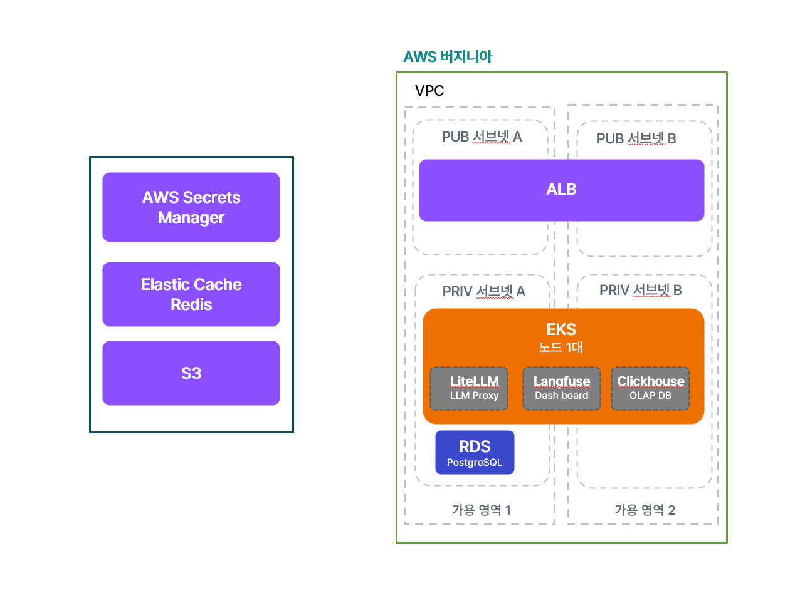
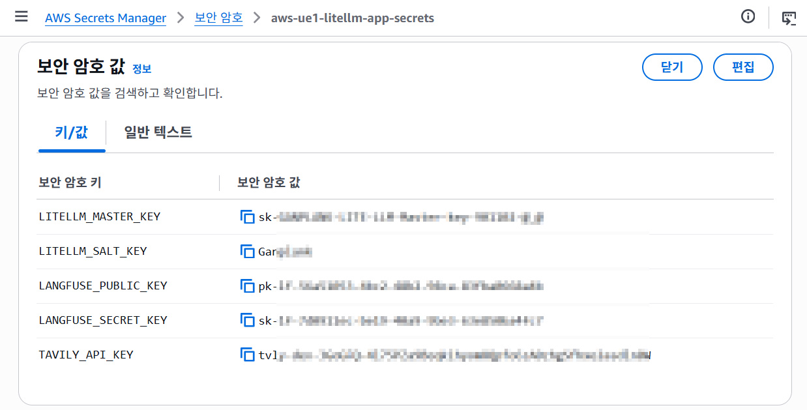
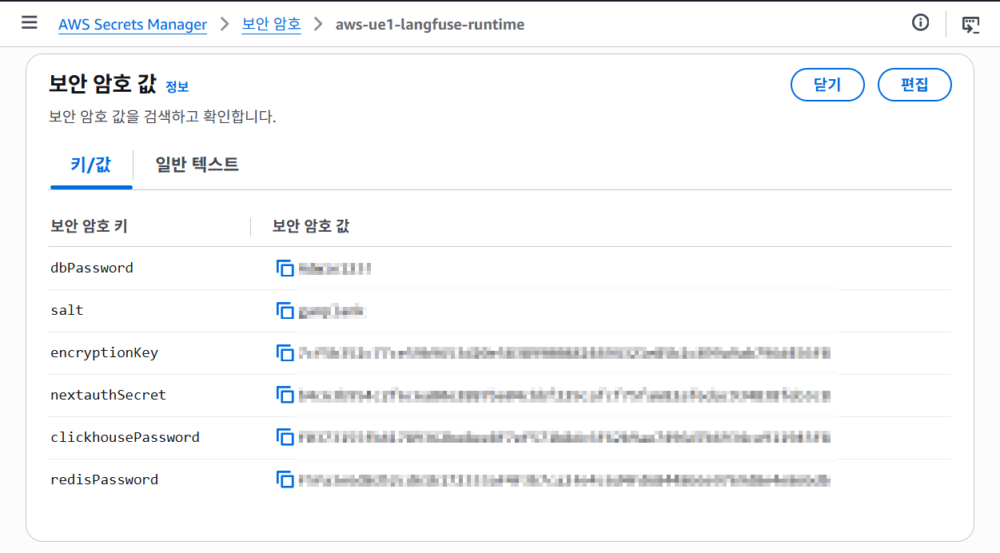
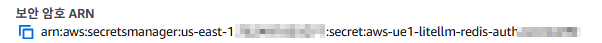
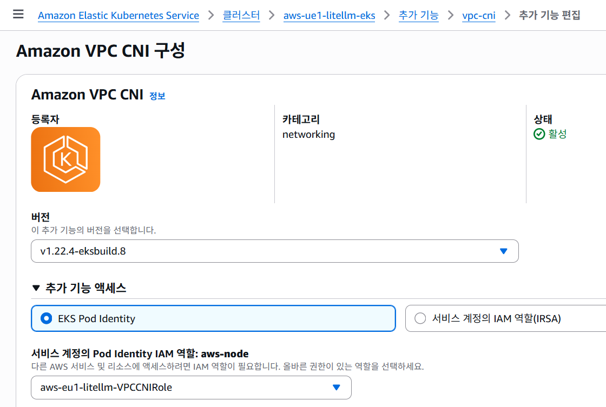
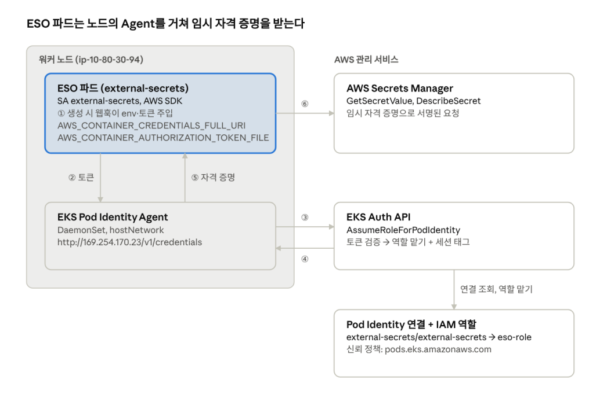
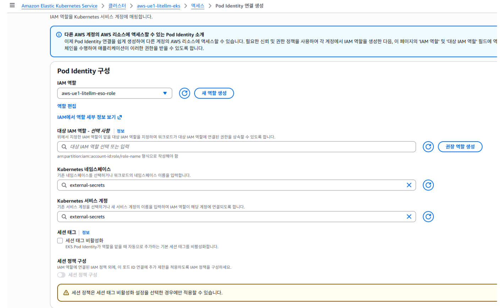

# EKS 기반 LiteLLM · Langfuse 실습 가이드

> 저장소: https://github.com/ganplankk/00-eks_litellm-langfuse_demo
> 리전: `us-east-1` 고정
> 콘솔 화면이 있는 단계(Secrets Manager, EKS, IAM, Pod Identity)는 AWS 콘솔에서 하고, 나머지는 터미널에 복사·붙여넣기로 진행합니다.
> 구성 설명과 설계 근거는 [reference/EKS(LITELLM+LANGFUSE)-full.md](<reference/EKS(LITELLM+LANGFUSE)-full.md>)에 있습니다.
> LiteLLM이 요청을 처리하는 순서와 `proxy_config` 설정 설명은 [LITELLM-PROXY.md](LITELLM-PROXY.md)에 있습니다.



## 진행 순서

| 단계 | 어디서 | 할 일 |
| --- | --- | --- |
| 1 | — | 로컬 도구, AWS에 미리 있어야 하는 리소스 확인 |
| 2 | 콘솔 | Secrets Manager 시크릿 만들기 |
| 3 | 터미널 | 저장소 받기, 내 환경 값 채우기 |
| 4 | 콘솔 | EKS 클러스터, 애드온, 노드 그룹 |
| 5 | 콘솔 | IAM 역할과 Pod Identity 연결 |
| 6 | 터미널 | 클러스터 공통 구성 설치 (ESO, LBC, cert-manager, ClickHouse operator) |
| 7 | 터미널 + 화면 | Langfuse 배포, 프로젝트 키 발급 |
| 8 | 터미널 | LiteLLM 배포 |
| 9 | 터미널 + 브라우저 | 동작 확인 |

리소스 이름(`aws-ue1-litellm-eks`, `aws-ue1-litellm-app-role` 등)은 저장소 파일과 맞춰져 있으므로 이 가이드의 이름을 그대로 씁니다.

---

## 1. 준비

### 1.1 로컬 도구

```bash
aws --version          # AWS CLI v2
kubectl version --client
helm version --short   # v3.13 이상 또는 v4
git --version
```

### 1.2 이미 있다고 가정하는 리소스

VPC, RDS(PostgreSQL), ElastiCache(Redis, TLS + AUTH)는 이미 만들어져 있고, EKS 노드에서 RDS(5432)·Redis(6379)로 접속할 수 있다고 가정합니다. 이 리소스들을 만드는 방법은 다루지 않습니다. 3단계에서 아래 값만 가져다 씁니다.

| 3단계에서 채울 값 | 어디서 확인 |
| --- | --- |
| `VPC_ID`, `PUBLIC_SUBNETS` | VPC ID, ALB를 둘 퍼블릭 서브넷 2개의 이름(Name 태그) |
| `RDS_ENDPOINT`, `RDS_MASTER_USER`, `RDS_SECRET_ARN` | RDS 엔드포인트, Secrets Manager의 `rds!db-…` 시크릿(사용자 이름, ARN) |
| `REDIS_ENDPOINT` | ElastiCache 기본 엔드포인트 |
| `LOG_BUCKET`, `LANGFUSE_BUCKET` | S3 버킷 2개 (LiteLLM 요청 로그용, Langfuse 이벤트용) |
| `ACM_CERT_ARN` | LiteLLM·Langfuse 도메인을 포함한 ACM 인증서 |
| `GUARDRAIL_ID` | Bedrock Guardrail ID (Claude Sonnet 4.6 모델 액세스 필요) |
| `LITELLM_HOST`, `LANGFUSE_HOST` | 사용할 도메인 2개 (DNS는 7·8단계에서 연결) |
| `ALLOWED_CIDR` | ALB에 접속할 내 공인 IP (`curl https://checkip.amazonaws.com`) |

Tavily API 키(웹 검색 도구)도 하나 준비합니다. 2단계에서 시크릿에 넣습니다.

---

## 2. Secrets Manager 시크릿 만들기 (콘솔)

**경로: Secrets Manager › 보안 암호 › 새 보안 암호 저장 › 다른 유형의 보안 암호(키/값)**


| 시크릿 이름 | 만드는 방법 | 키 |
| --- | --- | --- |
| `rds!db-…` | 이미 있음 (RDS 관리형 마스터 암호) | `username`, `password` |
| `aws-ue1-litellm-redis-auth` | 없으면 직접 생성 | `REDIS_PASSWORD` = ElastiCache AUTH 토큰과 같은 값 |
| `aws-ue1-litellm-app-secrets` | 직접 생성 | `LITELLM_MASTER_KEY`, `LITELLM_SALT_KEY`, `TAVILY_API_KEY` (Langfuse 키 2개는 7단계에서 추가) |
| `aws-ue1-langfuse-runtime` | 직접 생성 (**이름 그대로**) | `dbPassword`, `salt`, `encryptionKey`, `nextauthSecret`, `clickhousePassword` |

무작위 값은 아래 명령으로 만들어 붙여 넣습니다.

```bash
echo "LITELLM_MASTER_KEY  sk-$(openssl rand -hex 24)"
echo "LITELLM_SALT_KEY    $(openssl rand -hex 24)"
echo "dbPassword          $(openssl rand -hex 16)"
echo "salt                $(openssl rand -hex 16)"
echo "encryptionKey       $(openssl rand -hex 32)"
echo "nextauthSecret      $(openssl rand -hex 32)"
echo "clickhousePassword  $(openssl rand -hex 16)"
```





- `LITELLM_SALT_KEY`는 LiteLLM이 DB에 모델 자격 증명을 저장하기 시작한 뒤에는 바꾸지 않습니다.
- `dbPassword`는 7.1에서 Langfuse DB 계정을 만들 때 같은 값을 씁니다.

**ARN 3개 기록:** `rds!db-…`, `aws-ue1-litellm-redis-auth`, `aws-ue1-litellm-app-secrets` 상세 화면의 "보안 암호 ARN"을 복사해 둡니다.



---

## 3. 저장소 받기와 환경 값 채우기 (터미널)

저장소의 `manifests/`, `iam/` 파일에는 환경마다 다른 값이 `__AWS_ACCOUNT_ID__` 같은 자리표시자로 들어 있습니다. 원본은 그대로 두고, `build/`에 복사본을 만들어 내 값으로 채웁니다. 이후 단계는 모두 `build/`의 파일을 씁니다.

```bash
git clone https://github.com/ganplankk/00-eks_litellm-langfuse_demo.git
cd 00-eks_litellm-langfuse_demo
```

**① 값 파일 만들기** — 아래를 붙여 넣은 뒤 `lab.env`를 열어 예시 값을 내 값으로 바꿉니다.

```bash
cat > lab.env <<'EOF'
export AWS_PROFILE='default'
export AWS_ACCOUNT_ID='123456789012'
export VPC_ID='vpc-0123456789abcdef0'
export PUBLIC_SUBNETS='my-public-subnet-a,my-public-subnet-c'
export RDS_ENDPOINT='litellm-lab-db.xxxxxxxxxxxx.us-east-1.rds.amazonaws.com'
export RDS_MASTER_USER='litellm_admin'
export RDS_SECRET_ARN='arn:aws:secretsmanager:us-east-1:123456789012:secret:rds!db-xxxxxxxx-xxxx-xxxx-xxxx-xxxxxxxxxxxx-AbCdEf'
export REDIS_ENDPOINT='master.my-redis.xxxxxx.use1.cache.amazonaws.com'
export REDIS_SECRET_ARN='arn:aws:secretsmanager:us-east-1:123456789012:secret:aws-ue1-litellm-redis-auth-AbCdEf'
export APP_SECRET_ARN='arn:aws:secretsmanager:us-east-1:123456789012:secret:aws-ue1-litellm-app-secrets-AbCdEf'
export ACM_CERT_ARN='arn:aws:acm:us-east-1:123456789012:certificate/xxxxxxxx-xxxx-xxxx-xxxx-xxxxxxxxxxxx'
export GUARDRAIL_ID='abcd1234efgh'
export LOG_BUCKET='my-litellm-log-bucket'
export LANGFUSE_BUCKET='my-langfuse-event-bucket'
export LITELLM_HOST='litellm.example.com'
export LANGFUSE_HOST='langfuse.example.com'
export ALLOWED_CIDR='203.0.113.10/32'
EOF
${EDITOR:-vi} lab.env
```

- `PUBLIC_SUBNETS`는 서브넷 **이름(Name 태그)** 2개를 쉼표로 이어 씁니다.
- `RDS_MASTER_USER`는 RDS 시크릿의 `username` 값입니다(7.1에서 사용).
- 값은 작은따옴표 안에 넣습니다. RDS 시크릿 ARN의 `!` 때문입니다.
- `lab.env`와 `build/`는 `.gitignore`에 들어 있어 Git에 올라가지 않습니다.

**② `build/`에 복사하고 값 채우기**

```bash
source lab.env
rm -rf build && mkdir build && cp -r manifests iam build/
grep -rl '__[A-Z_]*__' build | xargs sed -i \
  -e "s|__RDS_SECRET_ARN__|${RDS_SECRET_ARN}|g" \
  -e "s|__REDIS_SECRET_ARN__|${REDIS_SECRET_ARN}|g" \
  -e "s|__APP_SECRET_ARN__|${APP_SECRET_ARN}|g" \
  -e "s|__ACM_CERT_ARN__|${ACM_CERT_ARN}|g" \
  -e "s|__RDS_ENDPOINT__|${RDS_ENDPOINT}|g" \
  -e "s|__REDIS_ENDPOINT__|${REDIS_ENDPOINT}|g" \
  -e "s|__ALLOWED_CIDR__|${ALLOWED_CIDR}|g" \
  -e "s|__GUARDRAIL_ID__|${GUARDRAIL_ID}|g" \
  -e "s|__LOG_BUCKET__|${LOG_BUCKET}|g" \
  -e "s|__LANGFUSE_BUCKET__|${LANGFUSE_BUCKET}|g" \
  -e "s|__LANGFUSE_HOST__|${LANGFUSE_HOST}|g" \
  -e "s|__LITELLM_HOST__|${LITELLM_HOST}|g" \
  -e "s|__PUBLIC_SUBNETS__|${PUBLIC_SUBNETS}|g" \
  -e "s|__AWS_ACCOUNT_ID__|${AWS_ACCOUNT_ID}|g"
grep -rn '__[A-Z_]*__' build || echo "모든 값이 채워졌습니다"
```

마지막 줄에 `모든 값이 채워졌습니다`가 나오면 됩니다. 값을 고쳤다면 `lab.env`를 수정하고 ② 블록을 다시 실행합니다. 새 터미널을 열 때마다 `cd 00-eks_litellm-langfuse_demo && source lab.env`를 먼저 실행합니다.

---

## 4. EKS 클러스터 만들기 (콘솔)

### 4.1 IAM 역할 2개

| 역할 | 신뢰 대상 | 연결할 AWS 관리형 정책 |
| --- | --- | --- |
| `aws-ue1-litellm-eks-cluster-role` | EKS (`eks.amazonaws.com`) | `AmazonEKSClusterPolicy` |
| `aws-ue1-litellm-eks-node-role` | EC2 (`ec2.amazonaws.com`) | `AmazonEKSWorkerNodePolicy`, `AmazonEC2ContainerRegistryPullOnly` |

IAM › 역할 › 역할 생성 › AWS 서비스에서 "EKS - Cluster", "EC2"를 고르면 신뢰 정책이 자동으로 들어갑니다.

### 4.2 클러스터 생성

**경로: EKS › 클러스터 추가 › 생성**

| 항목 | 설정값 |
| --- | --- |
| 클러스터 이름 | `aws-ue1-litellm-eks` |
| 클러스터 유형 | 일반 EKS 클러스터, Auto Mode 비활성화 |
| Kubernetes 버전 | 1.37 |
| 클러스터 IAM 역할 | `aws-ue1-litellm-eks-cluster-role` |
| 인증 모드 | EKS API, 클러스터 생성자 관리자 액세스 허용 |
| 네트워크 | 실습 VPC, 프라이빗 서브넷 2개 |
| API 엔드포인트 | 퍼블릭 및 프라이빗, 퍼블릭 접근 CIDR은 내 공인 IP |
| 추가 기능 | VPC CNI, CoreDNS, kube-proxy, EKS Pod Identity Agent, Amazon EBS CSI Driver |

상태가 `활성`이 될 때까지 기다립니다.

### 4.3 애드온 IAM 역할 (VPC CNI, EBS CSI)

**경로: EKS › 클러스터 › 추가 기능 › 해당 애드온 › 편집**

VPC CNI와 EBS CSI Driver는 "Pod Identity 연결"에서 **권장 역할 생성**을 눌러 역할을 만들고 연결합니다.

| 애드온 | 네임스페이스 / ServiceAccount | 권장 역할의 정책 |
| --- | --- | --- |
| Amazon VPC CNI | `kube-system` / `aws-node` | `AmazonEKS_CNI_Policy` |
| Amazon EBS CSI Driver | `kube-system` / `ebs-csi-controller-sa` | `AmazonEBSCSIDriverPolicy` |



### 4.4 노드 그룹

**경로: EKS › 클러스터 › aws-ue1-litellm-eks › 컴퓨팅 › 노드 그룹 추가**

| 항목 | 설정값 |
| --- | --- |
| 이름 | `aws-ue1-litellm-eks-m7` |
| 노드 IAM 역할 | `aws-ue1-litellm-eks-node-role` |
| AMI | Amazon Linux 2023 (x86_64) Standard |
| 인스턴스 / 용량 | `m7i.2xlarge` / 온디맨드 |
| 디스크 | 30 GiB |
| 크기 | 최소 1, 원하는 크기 1, 최대 1 |
| 서브넷 | 프라이빗 서브넷 1개 |
| 원격 액세스 | 끔 |


### 4.5 kubectl 연결

```bash
source lab.env
aws eks update-kubeconfig --region us-east-1 --name aws-ue1-litellm-eks
kubectl get nodes
kubectl get pods -n kube-system
```

노드 1개가 `Ready`이고, kube-system 파드가 모두 `Running`이면 됩니다.

---

## 5. IAM 역할과 Pod Identity 연결 (콘솔)

파드가 ServiceAccount에 연결된 IAM 역할의 권한으로 AWS API를 호출하게 하는 설정입니다. 역할마다 ① 권한 정책, ② 신뢰 정책, ③ Pod Identity 연결을 만듭니다.



**만들 역할 4개** (JSON은 모두 3단계에서 값을 채운 `build/iam/`에 있습니다)

| 역할 이름 | 권한 정책 | 신뢰 정책 | 네임스페이스 / ServiceAccount |
| --- | --- | --- | --- |
| `aws-ue1-litellm-eso-role` | `eso-read-secrets.json` | `eso-trust.json` | `external-secrets` / `external-secrets` |
| `aws-ue1-litellm-lbc-role` | `lbc-policy.json` (아래에서 내려받음) | `lbc-trust.json` | `kube-system` / `aws-load-balancer-controller` |
| `aws-ue1-litellm-app-role` | `litellm-bedrock.json`, `litellm-callbacks.json` | `litellm-trust.json` | `litellm` / `litellm` |
| `aws-ue1-langfuse-app-role` | `langfuse-s3.json` | `langfuse-trust.json` | `langfuse` / `langfuse` |

LBC 권한 정책을 내려받고, 콘솔에 붙여 넣을 JSON을 출력합니다.

```bash
curl -fsSL https://raw.githubusercontent.com/kubernetes-sigs/aws-load-balancer-controller/v3.6.2/docs/install/iam_policy.json \
  -o build/iam/lbc-policy.json
for f in build/iam/*.json; do echo "===== $f"; cat "$f"; echo; done
```

**역할마다 반복**

1. **권한 정책:** IAM › 정책 › 정책 생성 › JSON에 권한 정책 파일 내용을 붙여 넣고 저장합니다. 정책 이름은 파일 이름 앞에 `aws-ue1-`를 붙입니다(예: `eso-read-secrets.json` → `aws-ue1-eso-read-secrets`).
2. **역할:** IAM › 역할 › 역할 생성 › 사용자 지정 신뢰 정책에 신뢰 정책 파일 내용을 붙여 넣고, 1번 정책을 연결해 표의 이름으로 저장합니다. `aws-ue1-litellm-app-role`은 권한 정책 2개를 모두 연결합니다.
3. **Pod Identity 연결:** EKS › 클러스터 › `aws-ue1-litellm-eks` › 액세스 › Pod Identity 연결 › 생성에서 역할, 네임스페이스, ServiceAccount를 표대로 고릅니다. **"세션 태그 비활성화"는 체크하지 않습니다.** 신뢰 정책이 세션 태그로 클러스터·네임스페이스·ServiceAccount를 확인하기 때문입니다.



네임스페이스와 ServiceAccount가 아직 없어도 연결을 만들 수 있습니다. 6~8단계에서 만들어지는 파드에 자동으로 적용됩니다.

---

## 6. 클러스터 공통 구성 설치 (터미널)

```bash
source lab.env

# 네임스페이스
kubectl create namespace litellm --dry-run=client -o yaml | kubectl apply -f -
kubectl create namespace langfuse --dry-run=client -o yaml | kubectl apply -f -

# Helm 저장소
helm repo add external-secrets https://charts.external-secrets.io
helm repo add eks https://aws.github.io/eks-charts
helm repo add langfuse https://langfuse.github.io/langfuse-k8s
helm repo update

# External Secrets Operator: Secrets Manager → Kubernetes Secret 동기화
helm upgrade --install external-secrets external-secrets/external-secrets \
  -n external-secrets --create-namespace --version 2.14.0 \
  --set installCRDs=true --set serviceAccount.name=external-secrets \
  --wait --timeout 5m

# AWS Load Balancer Controller: Ingress → ALB 생성
helm upgrade --install aws-load-balancer-controller eks/aws-load-balancer-controller \
  -n kube-system --version 3.6.2 \
  --set clusterName=aws-ue1-litellm-eks --set region=us-east-1 --set vpcId="$VPC_ID" \
  --set replicaCount=1 \
  --set serviceAccount.create=true --set serviceAccount.name=aws-load-balancer-controller \
  --set controllerConfig.featureGates.ALBGatewayAPI=false \
  --set controllerConfig.featureGates.NLBGatewayAPI=false \
  --wait --timeout 5m

# cert-manager, ClickHouse operator: Langfuse 차트의 ClickHouse에 필요
helm upgrade --install cert-manager oci://quay.io/jetstack/charts/cert-manager \
  --version v1.20.2 -n cert-manager --create-namespace \
  --set crds.enabled=true --wait --timeout 10m
helm upgrade --install clickhouse-operator oci://ghcr.io/clickhouse/clickhouse-operator-helm \
  --version 0.0.8 -n clickhouse-operator --create-namespace \
  --wait --timeout 10m
```

확인:

```bash
kubectl get pods -n external-secrets
kubectl get pods -n kube-system -l app.kubernetes.io/name=aws-load-balancer-controller
kubectl get endpoints aws-load-balancer-webhook-service -n kube-system
kubectl get pods -n cert-manager
kubectl get pods -n clickhouse-operator
```

모든 파드가 `Running`이고, webhook 서비스의 `ENDPOINTS`에 IP가 보이면 됩니다.

---

## 7. Langfuse 배포

### 7.1 Langfuse DB 계정 만들기

RDS 마스터 계정으로 접속해 Langfuse 전용 계정과 DB를 만듭니다.

```bash
source lab.env
kubectl run pg-admin -n litellm --rm -it --restart=Never \
  --image=postgres:16.15-bookworm \
  --env=PGHOST="$RDS_ENDPOINT" --env=PGSSLMODE=require \
  -- psql -U "$RDS_MASTER_USER" -d postgres
```

- 암호를 물으면 RDS 시크릿의 `password`를 붙여 넣습니다(Secrets Manager › 보안 암호 값 검색).

psql 프롬프트에서 실행합니다.

```sql
CREATE ROLE langfuse_app LOGIN;
\password langfuse_app
GRANT langfuse_app TO CURRENT_USER;
CREATE DATABASE langfuse OWNER langfuse_app;
\q
```

`\password`가 암호를 물으면 2단계의 `dbPassword` 값을 입력합니다.

### 7.2 Helm 배포

```bash
source lab.env
helm upgrade --install langfuse langfuse/langfuse --version 2.1.7 \
  -n langfuse -f build/manifests/03-langfuse-values.yaml \
  --wait --timeout 20m
kubectl get pods,pvc,ingress -n langfuse
```

`langfuse-web`, `langfuse-worker`, `langfuse-clickhouse-0-0-0`, `langfuse-keeper-0-0`이 `Running`이고 PVC가 `Bound`면 됩니다. 처음 기동은 10분 이상 걸릴 수 있습니다.

### 7.3 DNS 연결

```bash
kubectl get ingress -n langfuse -o jsonpath='{.items[0].status.loadBalancer.ingress[0].hostname}{"\n"}'
```

출력된 ALB 주소로 `LANGFUSE_HOST`의 CNAME(또는 Route 53 별칭) 레코드를 만듭니다.

### 7.4 프로젝트 키 발급 → 앱 시크릿에 추가

1. 브라우저에서 `https://<LANGFUSE_HOST>`에 접속해 가입하고, 조직과 프로젝트를 만듭니다.
2. 프로젝트 Settings › API Keys › Create new API keys로 Public Key와 Secret Key를 발급합니다.
3. Secrets Manager › `aws-ue1-litellm-app-secrets` › 편집에서 두 키를 추가합니다.

| 키 | 값 |
| --- | --- |
| `LANGFUSE_PUBLIC_KEY` | `pk-lf-…` |
| `LANGFUSE_SECRET_KEY` | `sk-lf-…` |

---

## 8. LiteLLM 배포

```bash
source lab.env

# ① 사전 준비물: SecretStore, ExternalSecret 2개, ConfigMap 2개(CA 인증서, 콜백 py)
kubectl apply --server-side -k build/manifests/01-litellm-prereqs
kubectl wait --for=condition=Ready -n litellm --timeout=120s \
  secretstore/aws-secretsmanager \
  externalsecret/litellm-backend-secrets externalsecret/litellm-runtime-secrets

# ② LiteLLM Helm 차트 소스 (v1.103.3, 커밋 고정)
[ -d .vendor/litellm/.git ] || {
  git clone --depth 1 --filter=blob:none --sparse --branch v1.103.3 \
    https://github.com/BerriAI/litellm.git .vendor/litellm
  git -C .vendor/litellm sparse-checkout set helm/litellm-helm
}
[ "$(git -C .vendor/litellm rev-parse HEAD)" = ecae261b100cdf6bcb1d024ae69e4efa4a891be0 ] \
  && echo "차트 커밋 확인" || echo "차트 커밋이 다릅니다. 진행하지 마세요"
helm dependency build .vendor/litellm/helm/litellm-helm

# ③ 배포: DB 초기화 → migration → 앱
helm upgrade --install litellm .vendor/litellm/helm/litellm-helm -n litellm \
  -f build/manifests/04-litellm-values.yaml \
  --set-string podAnnotations.checksum/callbacks="$(cat build/manifests/01-litellm-prereqs/py/*.py | sha256sum | cut -c1-16)" \
  --wait --timeout 10m
kubectl logs job/litellm-db-init -n litellm
kubectl get pods,ingress -n litellm
```

- ① 다음 `wait`가 시간 초과되면 2단계 시크릿의 키 이름과 5단계 ESO 역할 정책을 확인합니다(10단계).
- `litellm-…` 파드가 `1/1 Running`이면 됩니다. 끝난 Job 파드의 `0/1 Completed`는 정상입니다.

DNS 연결:

```bash
kubectl get ingress litellm -n litellm -o jsonpath='{.status.loadBalancer.ingress[0].hostname}{"\n"}'
```

출력된 ALB 주소로 `LITELLM_HOST`의 CNAME(또는 Route 53 별칭) 레코드를 만듭니다.

---

## 9. 동작 확인

```bash
source lab.env

# 역할 확인 + readiness + Bedrock 호출 1회 (과금)
helm test litellm -n litellm --filter name=litellm-smoke-test --logs

# ALB 경유
curl -s -o /dev/null -w '%{http_code}\n' "https://${LITELLM_HOST}/health/readiness"
```

`helm test` 로그에 아래 세 가지가 나오고 `Phase: Succeeded`면 성공입니다.

```
AWS principal: arn:aws:sts::123456789012:assumed-role/aws-ue1-litellm-app-role/…
/health/readiness 200
"content": "EKS connection OK"
```

| 화면 | 주소 | 로그인 |
| --- | --- | --- |
| LiteLLM UI | `https://<LITELLM_HOST>/ui` | 사용자 `admin`, 암호 `LITELLM_MASTER_KEY` |
| Langfuse | `https://<LANGFUSE_HOST>` | 7.4에서 가입한 계정. `helm test` 호출이 Tracing 화면에 보이면 연동 성공 |

ALB는 `ALLOWED_CIDR`에서만 접속됩니다. 다른 곳에서 확인하려면 `kubectl port-forward -n litellm service/litellm 14000:4000` 후 `http://127.0.0.1:14000/ui`로 접속합니다.

---

## 10. 문제 해결

| 증상 | 확인할 것 |
| --- | --- |
| 3단계 마지막 줄에 `__…__`가 남아 있음 | `lab.env`에 빈 값이 있는지 확인하고 ② 블록을 다시 실행 |
| ExternalSecret이 Ready가 되지 않음 | `kubectl describe externalsecret -n litellm` 이벤트. 시크릿 키 이름(2단계), ESO 역할 정책의 ARN(5단계) |
| Helm 실패: `no endpoints available for service "aws-load-balancer-webhook-service"` | LBC 파드 상태(6단계) |
| Helm 실패: `job litellm-db-init failed` | `kubectl logs job/litellm-db-init -n litellm`. 노드에서 RDS로 접속이 되는지(1.2) |
| `helm test`의 AWS principal이 app-role이 아님 | Pod Identity 연결 `litellm` / `litellm`(5단계), 연결 후 `kubectl rollout restart deployment/litellm -n litellm` |
| `helm test`에서 `HTTP 403 … Bedrock guardrail request failed` | `aws-ue1-litellm-app-role`에 `litellm-callbacks.json` 정책이 연결됐는지 |
| Langfuse 배포가 `ClickHouse operator CRDs not found` | 6단계 cert-manager, ClickHouse operator 설치 |
| ClickHouse PVC가 `Pending` | EBS CSI 애드온과 역할(4.3). `kubectl apply -f build/manifests/02-gp3-pvc.yaml`로 EBS만 따로 확인 후 삭제 |
| 브라우저에서 접속이 안 됨 | DNS 레코드(7.3, 8단계), 접속 IP가 `ALLOWED_CIDR`와 같은지 |
| Secrets Manager 값을 바꿨는데 반영 안 됨 | `kubectl annotate externalsecret litellm-runtime-secrets -n litellm force-sync=$(date +%s) --overwrite` 후 `kubectl rollout restart deployment/litellm -n litellm` |

## 11. 정리

```bash
helm uninstall litellm -n litellm
kubectl delete -k build/manifests/01-litellm-prereqs
helm uninstall langfuse -n langfuse
kubectl get pv   # gp3-langfuse는 Retain이라 PV와 EBS 볼륨이 남습니다
```

남은 PV는 `kubectl delete pv <이름>`으로 지우고, EC2 › 볼륨에서 해당 EBS 볼륨을 삭제합니다. ALB는 Ingress가 지워지면 자동으로 삭제됩니다. EKS 클러스터와 노드 그룹, 5단계의 IAM 역할은 콘솔에서 삭제합니다.
