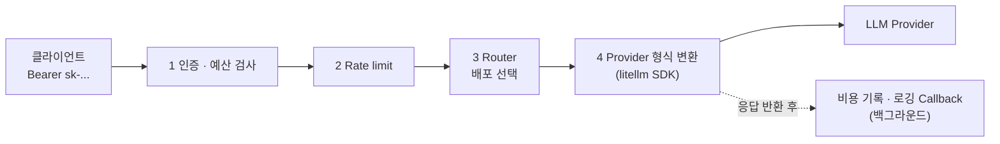
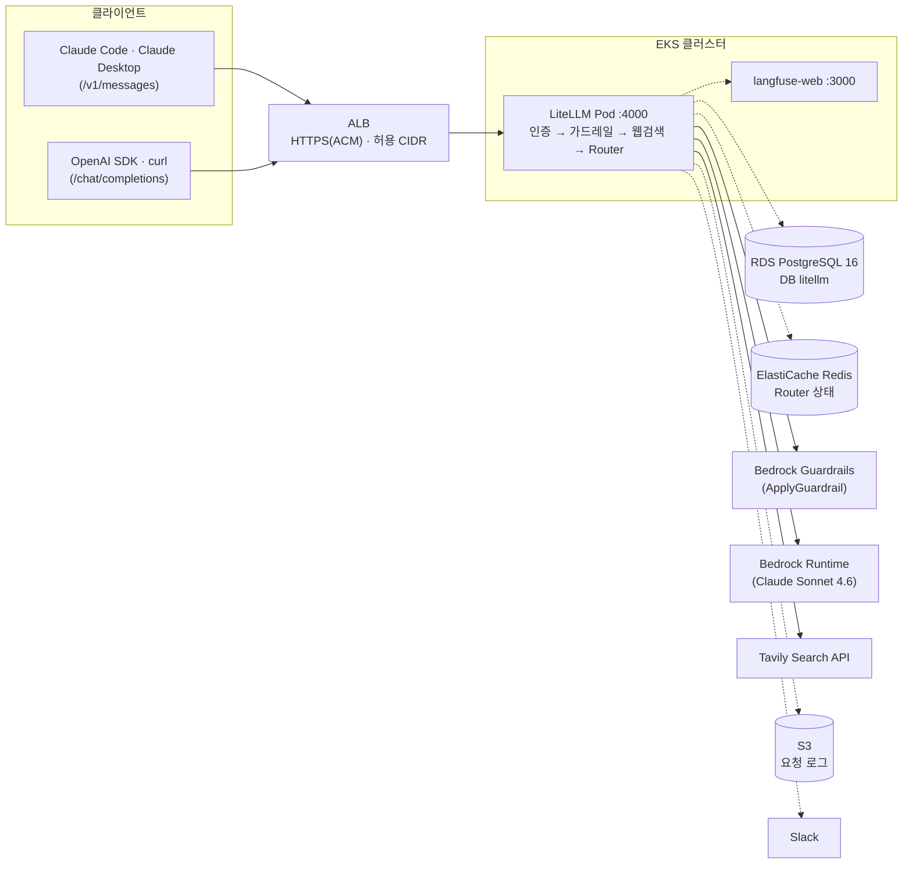
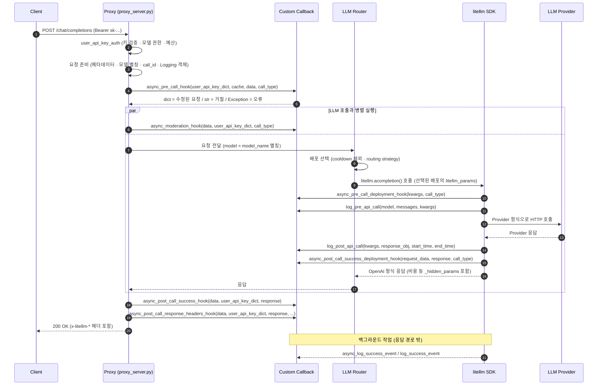
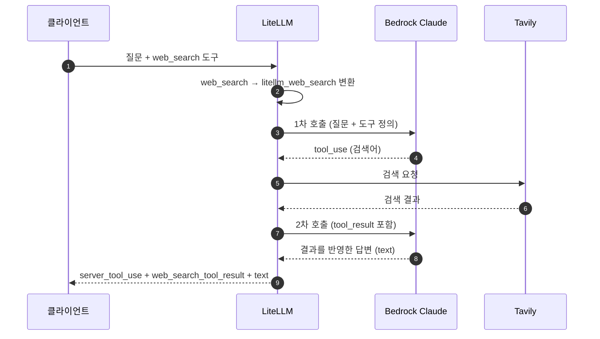
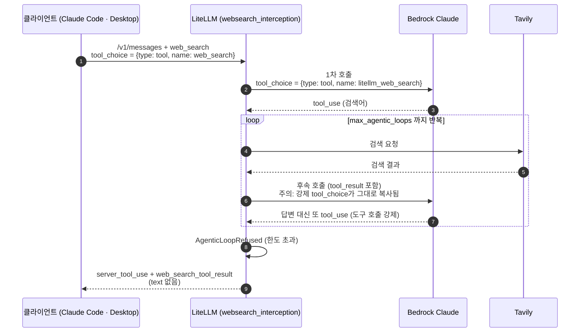

# LiteLLM Proxy 동작 이해하기

> 기준: 이 저장소의 [`manifests/04-litellm-values.yaml`](../manifests/04-litellm-values.yaml)과 [`manifests/01-litellm-prereqs/`](../manifests/01-litellm-prereqs/)
> 환경: EKS(`us-east-1`), LiteLLM 이미지 `1.103.3`(Helm 차트도 같은 버전 소스), RDS PostgreSQL 16, ElastiCache Redis, Amazon Bedrock(Claude Sonnet 4.6), Tavily 검색, Langfuse
> 최종 확인일: 2026-10-31 (업스트림 이슈 현황은 2026-10-29 기준)
> 설치 방법은 [실행 가이드](<EKS(LITELLM+LANGFUSE).md>)에 있습니다. 이 문서는 설치가 끝난 뒤 "LiteLLM이 요청을 어떻게 처리하는지, 저장소의 어느 설정이 그 동작을 정하는지"를 설명합니다.

## 이 문서를 읽는 방법

모든 장을 순서대로 읽을 필요는 없습니다. 궁금한 내용에 맞는 장으로 바로 가세요.

| 알고 싶은 것 | 읽을 장 |
| --- | --- |
| LiteLLM이 무엇이고 왜 쓰는지 | 1장 |
| 요청이 어떤 구성 요소를 거치는지 | 2장 |
| 내 코드(Callback)가 언제 실행되는지 | 3장 |
| 저장소 파일이 파드 안 어디로 들어가는지, 고친 뒤 어떻게 반영하는지 | 4장 |
| `proxy_config`의 각 설정 의미 | 5장 |
| 가드레일 차단 메시지, S3 로그, Langfuse | 6~8장 |
| 웹검색 흐름과 반복 검색 문제 | 9~10장 |
| 오류가 났을 때 | 11장 |

### 용어

| 용어 | 뜻 |
| --- | --- |
| Proxy (LLM Gateway) | 클라이언트와 LLM Provider 사이에서 요청을 받아 검사·변환·기록하는 서버. 이 저장소에서는 `litellm` 네임스페이스의 `litellm` Deployment |
| Provider | 실제 모델을 제공하는 서비스. 여기서는 Amazon Bedrock |
| master key | Proxy 관리자 키(`LITELLM_MASTER_KEY`). Virtual Key 발급과 Admin UI 로그인에 사용 |
| Virtual Key | master key로 발급하는 사용자용 키(`sk-...`). 키마다 허용 모델, 예산, 사용량을 관리 |
| 모델 별칭 (`model_name`) | 클라이언트가 요청에 넣는 모델 이름. 여기서는 `claude-sonnet-4-6` |
| 배포 (deployment) | 별칭 뒤에 있는 실제 모델 설정 하나(`litellm_params`). 쿠버네티스 Deployment와는 다른 뜻 |
| Callback / Hook | 요청 처리 중 정해진 시점에 LiteLLM이 불러 주는 사용자 코드 |
| 가드레일 | 입력이나 출력을 검사해 차단·마스킹하는 Callback |
| server tool | Provider 서버가 직접 실행하는 도구. Anthropic API의 `web_search`가 예 |
| Pod Identity | 파드의 ServiceAccount에 IAM 역할을 연결하는 EKS 기능. LiteLLM 파드는 이 방식으로 AWS 자격 증명을 받으며, 액세스 키를 쓰지 않음 |
| ESO (External Secrets Operator) | Secrets Manager 값을 쿠버네티스 Secret으로 복사해 주는 컨트롤러 |

## 목차

1. LiteLLM이란?
2. 아키텍처
3. 요청 LifeCycle
4. 저장소의 LiteLLM 구성
5. `proxy_config` 설정
6. 가드레일 차단 메시지를 한국어로 바꾸기
7. S3에 필요한 로그 필드만 남기기
8. Langfuse로 trace 보내기
9. 인터넷 검색이 동작하는 순서
10. 트러블슈팅: `/v1/messages`에서 웹검색이 반복되고 답변이 오지 않는 문제
11. 자주 겪는 오류와 확인 지점

---

## 1. LiteLLM이란?

**LiteLLM**은 OpenAI, Anthropic, Amazon Bedrock, Vertex AI 등 100개가 넘는 LLM Provider를 **하나의 API 규격**으로 호출하고 관리하게 해 주는 오픈소스 프로젝트입니다. 기본 규격은 OpenAI API(`/chat/completions`)이고, Claude SDK가 쓰는 Anthropic Messages API(`/v1/messages`), Embeddings, Images 같은 엔드포인트도 지원합니다.

LiteLLM은 두 가지 형태로 쓸 수 있습니다.

| 형태 | 설명 | 주 사용처 |
| --- | --- | --- |
| Python SDK | 애플리케이션 코드에서 `litellm.completion()`을 직접 호출. Provider별 요청·응답 형식 변환을 라이브러리가 처리 | 애플리케이션 하나에서 여러 모델을 바꿔 가며 사용 |
| Proxy Server (LLM Gateway) | SDK를 FastAPI 서버로 감싼 중앙 관문. 클라이언트는 Provider 자격 증명 대신 LiteLLM이 발급한 Virtual Key로 호출 | 조직 단위로 여러 사용자·팀의 LLM 사용을 통제 |

이 문서는 **Proxy Server** 형태를 다룹니다. Proxy의 핵심은 여러 사용자의 LLM 요청을 한곳에서 받아 통제한다는 점입니다.

| 기능 | 설명 |
| --- | --- |
| 통합 API | 클라이언트는 OpenAI 또는 Anthropic 형식으로 호출하고, LiteLLM이 Provider 고유 형식으로 변환 |
| 키·권한 관리 | Virtual Key, 사용자·팀 단위 허용 모델 지정. 실제 Provider 자격 증명은 Proxy에만 있음 |
| 비용·사용량 통제 | 키·사용자·팀별 토큰 사용량과 비용 집계, 예산(budget)과 RPM/TPM 제한 |
| 라우팅 | 같은 모델 별칭에 여러 배포를 묶어 로드밸런싱, retry, fallback |
| 가드레일 | 입력·출력 콘텐츠 필터, 민감정보 마스킹, 외부 가드레일(예: Bedrock Guardrails) 연동 |
| 로깅·관측 | 요청 로그(Spend Logs), S3·Langfuse·OpenTelemetry 같은 외부 로깅 연동, Slack 알림 |
| 확장성 | 요청 처리 구간마다 Custom Callback(Hook)을 걸어 요청·응답·오류를 직접 가공 (3장) |

금융권에서는 망 분리 규제 개선에 따라, 제도와 보안 요건을 충족하는 범위에서 외부 클라우드와 생성형 AI 활용이 늘고 있습니다. LLM Gateway를 Amazon Bedrock과 연동하면 민감정보 필터링, 접근 제어, 감사 로그 같은 보안 통제를 한곳에 모을 수 있습니다.

이 저장소의 가드레일은 Bedrock의 **ApplyGuardrail API**를 씁니다. 이 API는 모델 호출과 분리되어 있어서, 어떤 모델의 입력·출력이든 같은 가드레일 정책으로 검사할 수 있습니다. LiteLLM은 가드레일 단계에서 이 API를 호출합니다(5.4). 개념은 [AWS 문서: ApplyGuardrail API](https://docs.aws.amazon.com/bedrock/latest/userguide/guardrails-use-independent-api.html)에 그림과 함께 나와 있습니다.

## 2. 아키텍처

---

### 2.1. 요청 하나가 거치는 단계

LiteLLM 공식 문서([Life of a Request](https://docs.litellm.ai/docs/proxy/architecture))의 흐름을 단순하게 그리면 다음과 같습니다.



*그림 1. LiteLLM Gateway 요청 처리 흐름. 실선은 요청 경로, 점선은 응답을 돌려준 뒤 실행되는 작업입니다.*

| 순서 | 단계 | 하는 일 |
| --- | --- | --- |
| 1 | Auth and budget checks | Virtual Key를 해시해 캐시를 먼저 찾고, 없으면 DB를 조회. 키 차단·만료, 허용 모델, 예산 검사 |
| 2 | Rate limiting | 키·사용자·팀·서버 단위 RPM/TPM과 동시 요청 수 검사 |
| 3 | Router | `model_name` 별칭에 묶인 배포 중 하나를 선택. 로드밸런싱, retry, fallback |
| 4 | Provider translation | litellm SDK가 OpenAI 형식 요청을 Provider 형식으로 바꿔 호출하고, 응답을 다시 OpenAI 형식으로 변환 |

알아 둘 점이 두 가지 있습니다.

- 비용 기록, Rate Limit 집계, 로깅 Callback은 응답을 돌려준 **뒤에** 백그라운드에서 실행됩니다. 요청 경로에는 DB 쓰기가 없습니다.
- Router와 litellm SDK는 별도 서버가 아니라 **Proxy 프로세스 안의 Python 모듈**입니다. 클라이언트 → LiteLLM → Provider 사이에 추가로 거치는 서버는 없습니다.

### 2.2. 구성 요소와 이 저장소의 설정

| 구성 요소 | 역할 | 이 저장소 |
| --- | --- | --- |
| Proxy Server | FastAPI 기반 메인 서버. 엔드포인트 수신, 인증, Hook 실행, 응답 반환 | `litellm` Deployment 1개(`replicaCount: 1`, `numWorkers: 1`), 포트 4000 |
| Router | `model_list`로 만들어지는 배포 선택기 | 배포 1개(`claude-sonnet-4-6`) |
| litellm SDK | Provider별 요청 변환, 인증(Bedrock은 AWS SigV4), HTTP 호출, 비용 계산 | Bedrock 호출에 Pod Identity 자격 증명 사용 |
| Callbacks / Guardrails | 요청 처리 구간마다 실행되는 Hook | 가드레일 1개, Callback 3개(5.2) |
| PostgreSQL | Virtual Key, 사용자, 팀, Spend 로그, DB에 저장한 모델·설정 | RDS의 `litellm` DB. Helm hook(`litellm-db-init`)이 DB를 만들고, migration Job이 스키마를 적용 |
| Redis | Router가 배포 cooldown과 RPM/TPM 사용량을 여러 Proxy 인스턴스와 공유하는 저장소 | ElastiCache(TLS, DB 0)를 `router_settings.redis_url`로 연결. 지금은 Proxy가 1개라 공유 효과는 없음 |
| Admin UI | 키·팀·모델·가드레일 관리 화면 | `https://<LITELLM_HOST>/ui` (ALB, 허용 CIDR만 접속) |
| 외부 기록 | 요청 로그, trace, 알림 | S3(7장), Langfuse(8장), Slack(5.5) |

### 2.3. 실습 구성도



*그림 2. 실습 구성도. 실선은 요청 경로, 점선은 조회 또는 백그라운드 기록입니다. Bedrock과 S3 호출은 Pod Identity로 받은 `aws-ue1-litellm-app-role` 권한을 씁니다. Langfuse로 가는 trace는 클러스터 내부 주소로 가므로 ALB를 거치지 않습니다.*

### 2.4. 엔드포인트와 형식 변환

클라이언트가 보낸 형식과 Provider가 받는 형식이 달라도 LiteLLM이 중간에서 변환합니다. 같은 `model_name`(`claude-sonnet-4-6`)을 두 엔드포인트에서 모두 쓸 수 있습니다.

| 엔드포인트 | 요청 형식 | 주요 클라이언트 | Hook의 `call_type` |
| --- | --- | --- | --- |
| `/chat/completions`, `/v1/chat/completions` | OpenAI Chat Completions | OpenAI SDK, LangChain, curl | `completion` / `acompletion` |
| `/v1/messages` | Anthropic Messages | Anthropic SDK(Claude SDK), Claude Code, Claude Desktop(게이트웨이 모드) | `anthropic_messages` |

웹검색은 엔드포인트와 Provider 조합에 따라 처리하는 곳이 다릅니다.

- **Anthropic API를 직접 호출할 때:** `web_search_20250305`는 Anthropic 서버가 실행하는 server tool입니다. 검색과 답변 작성이 API 호출 한 번으로 끝납니다.
- **Bedrock을 거칠 때(이 저장소):** Bedrock은 이 server tool을 실행하지 않습니다. 그래서 LiteLLM이 검색 도구를 일반 함수 도구(`litellm_web_search`)로 바꿔 모델에 보내고, 모델이 검색을 요청하면 Tavily로 검색한 뒤 결과를 넣어 모델을 **한 번 더 호출**합니다(9장). 10장의 문제는 이 "한 번 더 호출"에서 생깁니다.

## 3. 요청 LifeCycle

---

LiteLLM Proxy가 요청을 받아 가드레일을 적용하고, Provider에 전달하고, 응답이나 실패를 처리하는 전체 과정입니다. LiteLLM은 각 구간에 Hook을 걸 수 있는 지점을 제공하므로, 원하는 동작을 Custom Callback으로 넣을 수 있습니다.

### 3.1. 한눈에 보기

아래는 `/chat/completions` non-streaming 성공 요청 기준입니다. 번호는 3.2 그림의 번호와 같습니다.

| 구간 | 번호 | 하는 일 | 요청 경로 안인가 | 응답을 바꿀 수 있나 |
| --- | --- | --- | --- | --- |
| A. 수신·인증 | 1~2 | 키 검증, 모델 권한, 예산 | 안 | 실패하면 오류로 종료 |
| B. 요청 준비 | 3 | 메타데이터, 모델 별칭, 추적 ID, Logging 객체 | 안 | — |
| C. Pre-call Hook | 4~5 | 가드레일(`pre_call`), Rate Limit, 요청 수정·거절 | 안 (순서대로 실행) | 요청을 바꾸거나 거절 |
| D. LLM 호출 | 6~17 | Moderation과 LLM 호출을 병렬 실행, 배포 선택, Provider 호출 | 안 | 배포 단위 Hook에서 가능 |
| E. 응답 후처리 | 18~20 | 가드레일(`post_call`), 응답 헤더, 200 반환 | 안 | 응답 교체·차단 가능 |
| F. 백그라운드 로깅 | 21 | 비용 기록, S3, Langfuse | **밖** | 불가 |

"요청 경로 안"에서 쓴 시간은 모두 응답 지연에 더해집니다. 무거운 작업은 F 구간에 두는 것이 좋습니다.

### 3.2. Hook 실행 순서



*그림 3. 성공 요청의 Hook 실행 순서. LiteLLM 공식 문서([Call Hooks](https://docs.litellm.ai/docs/proxy/call_hooks))와 소스 코드(`proxy_server.py`, `common_request_processing.py`, `router.py`)를 대조해 작성했습니다.*

### 3.3. 단계별 상세

**A. 요청 수신과 인증 [1]~[2]** — 키가 유효한지, 이 모델을 쓸 수 있는지, 예산이 남았는지 확인합니다.

**[1] Client → Proxy: `POST /chat/completions`**

- 클라이언트(OpenAI SDK 등)가 `Authorization: Bearer sk-...` 헤더와 함께 요청을 보냅니다.
- `proxy_server.py`의 `chat_completion` 엔드포인트가 받습니다. `/v1/chat/completions`, `/chat/completions`, Azure 호환 경로(`/openai/deployments/{model}/chat/completions`)가 모두 이 함수로 연결됩니다.

**[2] `user_api_key_auth`: 키 검증 · 모델 권한 · 예산 검사**

- 엔드포인트 본문보다 먼저, FastAPI 의존성(`Depends(user_api_key_auth)`)으로 실행됩니다.
- `sk-` 키를 해시한 값으로 캐시를 먼저 찾고, 없으면 DB(`LiteLLM_VerificationToken`)를 조회합니다. 요청 처리 중 DB를 읽는 유일한 지점입니다.
- 키 차단(`blocked`)과 만료(`expires`), 요청한 모델에 대한 권한, 키·사용자·팀·최종 사용자(end user)·Proxy 전체 예산을 검사합니다.
- 통과하면 `UserAPIKeyAuth` 객체가 만들어지고, 이후 Hook에 `user_api_key_dict`로 전달됩니다. `key_alias`, `user_id`, `team_id`, `team_alias`, `user_role`, `models`, `metadata` 등이 들어 있습니다.
- 실패하면 401·400 등 오류 응답으로 끝나고, 이후 단계는 실행되지 않습니다.

**B. 요청 준비 [3]** — 이후 단계와 로그에서 쓸 정보를 요청에 붙입니다.

**[3] 요청 데이터 준비** (`common_request_processing.py`의 `common_processing_pre_call_logic`)

- **메타데이터 주입** (`add_litellm_data_to_request`): 클라이언트가 보낸 `metadata` 중 `user_api_key_`로 시작하는 값은 위조 방지를 위해 지우고, 인증된 키 정보(`user_api_key_hash`, `user_api_key_alias`, `user_api_key_team_id` 등)와 원본 요청(`proxy_server_request`: url·method·headers·body), 태그를 채웁니다. Logging Hook이 받는 `kwargs["litellm_params"]["metadata"]`가 여기서 만들어집니다.
- **모델 이름 정리**: `litellm.model_alias_map`이나 키에 설정된 `aliases`가 있으면 모델 이름을 바꾸고, 키·팀 단위 `router_settings`가 있으면 요청별 override로 붙입니다.
- **`litellm_call_id` 지정**: 클라이언트가 `x-litellm-call-id` 헤더를 보내면 그 값을, 없으면 새 UUID를 씁니다. 응답 헤더와 Spend 로그에서 요청을 추적하는 ID입니다.
- **Logging 객체 생성** (`function_setup`): Hook보다 **먼저** 만들어서, [4]에서 거절된 요청도 로그에 남게 합니다. 이 객체가 SDK 호출까지 그대로 전달되고, 객체의 `model_call_details`가 나중에 Logging Hook이 받는 `kwargs`가 됩니다.

**C. Pre-call Hook [4]~[5]** — 모델을 부르기 전에 요청을 검사하거나 바꿉니다. 이 저장소의 Bedrock 가드레일이 여기서 실행됩니다.

**[4] `async_pre_call_hook(user_api_key_dict, cache, data, call_type)`**

- `litellm.callbacks`에 등록된 Callback 중 이 메서드를 오버라이드한 것만 **순서대로 하나씩** 실행합니다. 앞 Callback이 바꾼 `data`를 다음 Callback이 받습니다. `pre_call` 모드 가드레일도 이 루프에서 함께 실행됩니다.
- **내장 Rate Limiter도 여기서 실행됩니다.** Proxy는 시작할 때 `parallel_request_limiter`(`MaxParallelRequestsHandler`)를 내부 Callback으로 등록하고, 이 단계에서 키·사용자·팀의 RPM/TPM과 동시 요청 수를 검사합니다. 그림 1의 "Rate limit"이 실제로는 이 Hook입니다.
- `cache`는 Proxy의 `DualCache`(In-Memory + Redis)로, Callback이 카운터나 상태를 저장하고 조회할 때 쓸 수 있습니다.
- 이 시점의 `data["model"]`은 아직 별칭(`claude-sonnet-4-6`)입니다. Router가 배포를 고르기 전입니다.

**[5] 반환값 처리**

| 반환값 | 결과 |
| --- | --- |
| `dict` | 그 dict로 요청을 바꿔서 계속 진행 |
| `str` | 거절. chat/text completion은 그 문자열이 assistant 응답(200)으로, 그 외 엔드포인트는 400 오류로 반환 |
| `Exception` 반환 또는 `raise` | 오류로 종료 |
| `None` | 그대로 진행 |

**D. LLM 호출과 Moderation 병렬 실행 [6]~[17]** — 배포를 고르고 Provider를 호출합니다. 그동안 Moderation 검사가 병렬로 돕니다.

Proxy는 [6]의 Moderation 작업과 [7]~[17]의 LLM 호출 작업을 각각 task로 만들고, `asyncio.gather`로 둘 다 끝날 때까지 기다립니다.

**[6] `async_moderation_hook(data, user_api_key_dict, call_type)`**

- 이 메서드를 오버라이드한 Callback과 `during_call` 모드 가드레일이 **서로 병렬로**, 그리고 LLM 호출과도 병렬로 실행됩니다.
- 예외를 던지면 LLM 응답 대신 그 오류가 반환되고, 진행 중인 LLM 호출 task는 취소됩니다. 이미 Provider에 요청이 전달됐다면 비용은 발생할 수 있습니다.
- 반환값은 쓰이지 않습니다. 요청을 바꾸는 용도가 아니라 검사·차단 용도입니다.
- LLM 호출보다 오래 걸리면 그만큼 응답이 늦어집니다. 둘 다 끝나야 다음 단계로 넘어가기 때문입니다.

**[7] Proxy → LLM Router: 요청 전달** (`route_llm_request.py`의 `route_request`)

- 요청한 `model`이 `model_name`, wildcard 패턴(예: `openai/*`), 배포 이름 중 어느 것과 맞는지 확인해 알맞은 Router 메서드(`llm_router.acompletion`)를 호출합니다. 맞는 것이 없으면 모델을 찾을 수 없다는 오류가 납니다.
- Router 호출은 `async_function_with_fallbacks` → `async_function_with_retries` → `_acompletion` 순서로 감싸져 있어서, 실패하면 이 안에서 retry와 fallback이 처리됩니다.

**[8] 배포 선택** (`Router._acompletion` → `async_get_available_deployment`)

같은 `model_name`으로 등록된 배포 묶음(model group)에서 하나를 고릅니다.

- 최근 실패로 **cooldown** 중인 배포는 제외합니다.
- `enable_pre_call_checks`를 켰다면 context window 초과 등 조건이 맞지 않는 배포도 제외합니다.
- 남은 배포 중 **routing strategy**로 하나를 고릅니다. 기본값 `simple-shuffle`은 무작위 선택이고, `weight`·`rpm`·`tpm`을 설정하면 그 비율로 분산합니다. 그 밖에 `least-busy`, `latency-based-routing`, `usage-based-routing`, `cost-based-routing`이 있습니다.
- 이 동작을 조정하는 설정이 `router_settings`입니다. 이 저장소는 배포가 하나라서 그 배포를 그대로 씁니다.

**[9] LLM Router → litellm SDK: `litellm.acompletion()` 호출**

- 선택된 배포의 `litellm_params`(실제 모델 `bedrock/...`, 리전 등)를 요청에 합쳐서 호출합니다. 이때부터 `model`은 실제 Provider 모델 이름입니다.

**[10] `async_pre_call_deployment_hook(kwargs, call_type)`**

- `litellm.acompletion`을 감싼 `@client` 래퍼가 실행합니다. **시도마다** 실행되므로 retry나 fallback이 일어나면 다시 호출됩니다.
- 배포가 정해진 **뒤의** 요청을 수정할 수 있는 지점입니다. 수정한 `kwargs`를 반환하면 그 값으로 호출합니다.
- 이어서 캐시가 켜져 있으면 캐시를 확인합니다. 캐시 히트면 [11]~[15]를 건너뛰고 Provider 호출 없이 캐시 응답을 돌려줍니다. 이 저장소는 응답 캐시(`litellm_settings.cache`)를 켜지 않았습니다.

**[11] `log_pre_api_call(model, messages, kwargs)`**

- Provider 설정 클래스가 요청을 다 준비한 뒤, **HTTP 전송 직전**에 호출됩니다. 준비 과정은 인증 헤더 구성(`validate_environment`), 최종 URL 결정(`get_complete_url`), OpenAI → Provider 형식 변환(`transform_request`), 필요하면 요청 서명(`sign_request`, Bedrock은 AWS SigV4)입니다.
- Provider로 실제 보내는 요청 본문은 `kwargs["additional_args"]["complete_input_dict"]`에 있습니다.
- **동기 메서드이고 요청 경로에서 바로 실행**되므로, 무거운 작업을 넣으면 그대로 응답이 느려집니다.

**[12]~[13] Provider HTTP 호출과 응답**

- 비동기 HTTP 클라이언트(httpx)로 Provider API를 직접 호출합니다. Provider 자격 증명은 이 호출에만 쓰이고 클라이언트에는 노출되지 않습니다.

**[14] `log_post_api_call(kwargs, response_obj, start_time, end_time)`**

- Provider 응답을 받은 직후, OpenAI 형식으로 바꾸기 **전에** 호출됩니다(`transform_response` 시작 부분).
- 이 시점에는 `response_obj`와 `end_time`이 `None`이고, Provider 원본 응답 텍스트는 `kwargs["original_response"]`에 있습니다.
- [11]과 마찬가지로 동기 메서드이며 요청 경로에서 실행됩니다.
- 이후 `transform_response`가 Provider 응답을 OpenAI 형식의 `ModelResponse`로 바꿉니다.

**[15] `async_post_call_success_deployment_hook(request_data, response, call_type)`**

- OpenAI 형식으로 바뀐 응답을 받는 배포 단위 Hook입니다. 수정한 응답을 반환하면 그 값이 이후 단계로 전달됩니다.
- 이어서 SDK 래퍼가 비용(`response_cost`), 배포 ID, `api_base` 등을 응답의 `_hidden_params`에 기록하고, [21]의 성공 로깅을 백그라운드에 예약합니다. post-call 가드레일이 켜져 있으면 예약을 [18] 이후로 미룹니다.

**[16]~[17] SDK → Router → Proxy: 응답 반환**

- Router를 거쳐 Proxy로 응답이 돌아옵니다. Proxy는 [6]의 Moderation까지 끝나야 다음 단계로 넘어갑니다.

**E. 응답 후처리 [18]~[20]** — 클라이언트에 보내기 전에 응답을 마지막으로 검사하거나 바꿉니다.

**[18] `async_post_call_success_hook(data, user_api_key_dict, response)`**

- non-streaming 성공 응답에서만 실행됩니다. `post_call` 모드 가드레일이 먼저 실행되고, 이어서 Callback들이 순서대로 실행됩니다.
- `None`이 아닌 값을 반환하면 그 값으로 응답이 바뀝니다. 예외를 던지면 클라이언트는 오류를 받습니다(출력 차단 용도).
- 내장 Rate Limiter는 여기서 동시 요청 슬롯을 반납하고 rate limit 헤더를 응답에 붙입니다.

**[19] `async_post_call_response_headers_hook(data, user_api_key_dict, response, request_headers)`**

- 각 Callback이 반환한 dict를 합쳐 HTTP 응답 헤더에 추가합니다. 실패 응답에서도 실행되며, 이때 `response`는 `None`입니다.
- Proxy는 이와 별도로 `x-litellm-call-id`, `x-litellm-model-id`, `x-litellm-model-api-base`, `x-litellm-response-cost`, `x-litellm-key-spend` 같은 기본 헤더를 붙입니다.

**[20] Proxy → Client: `200 OK`**

- OpenAI 호환 JSON 응답을 반환합니다. 여기까지가 클라이언트가 기다리는 구간입니다.

**F. 백그라운드 로깅 [21]** — 응답과 별개로 기록합니다. 이 저장소의 S3 로그와 Langfuse trace가 여기서 나갑니다.

**[21] `async_log_success_event` / `log_success_event`**

- [15]에서 예약된 로깅이 응답과 별개로 실행됩니다. async 메서드는 로깅 worker 큐에서, 동기 `log_success_event`는 thread pool에서 실행됩니다. 예약 시점이 [15]라서 [18]~[20]과 동시에 진행될 수 있습니다.
- `kwargs`에 `standard_logging_object`, `response_cost`, 메타데이터가 모두 채워진 상태라 기록과 집계에 가장 알맞습니다.
- LiteLLM 내장 기능도 이 Hook으로 동작합니다. `_ProxyDBLogger`가 키·사용자·팀 spend를 DB에 반영하고, Rate Limiter가 TPM 사용량을 갱신하며, Langfuse·OTEL 같은 연동도 여기서 전송됩니다.
- 응답이 이미 나간 뒤라 응답을 바꿀 수 없고, 여기서 난 예외는 요청 결과에 영향을 주지 않습니다.

### 3.4. 이 저장소의 코드가 실행되는 지점

| 코드 (`proxy_config` 이름) | 파일 | 실행 지점 | 요청 경로 |
| --- | --- | --- | --- |
| 가드레일 `aws-bedrock-guardrail` | `my_bedrockguardrail.py` | `/chat/completions`는 [4] `async_pre_call_hook`, `/v1/messages`는 통합 가드레일 경로의 `apply_guardrail` (6장) | 안 (지연에 더해짐) |
| `websearch_tool_choice_handler.handler` | `websearch_tool_choice_handler.py` | 웹검색 요청 변환과 후속 호출 (9~10장) | 안 |
| `s3_access_logger_handler.handler` | `s3_access_logger_handler.py` | [21] `async_log_success_event` (7장) | 밖 |
| `langfuse_otel` | LiteLLM 내장 | [21] 로깅 단계 (8장) | 밖 |
| `alerting: [slack]` | LiteLLM 내장 | 예외·지연 감지 시 (5.5) | 밖 |

## 4. 저장소의 LiteLLM 구성

---

### 4.1. 파일과 역할

| 파일 | 역할 |
| --- | --- |
| [`manifests/04-litellm-values.yaml`](../manifests/04-litellm-values.yaml) | LiteLLM Helm values. 이미지, `proxy_config`(LiteLLM 설정), 환경 변수, 볼륨, Ingress(ALB), DB 초기화 hook, `helm test`용 smoke test |
| [`manifests/01-litellm-prereqs/kustomization.yaml`](../manifests/01-litellm-prereqs/kustomization.yaml) | Helm 설치 전에 있어야 하는 리소스 묶음. ConfigMap 2개(CA 인증서, Python 코드)를 파일에서 생성 |
| [`runtime-secrets.yaml`](../manifests/01-litellm-prereqs/runtime-secrets.yaml) | LiteLLM 파드 환경 변수용 Secret(`litellm-runtime-secrets`). `DATABASE_URL`, `REDIS_URL`, master/salt key, Langfuse 키·주소, Tavily 키 |
| [`backend-secrets.yaml`](../manifests/01-litellm-prereqs/backend-secrets.yaml) | DB 초기화 Job용 Secret(`litellm-backend-secrets`). RDS 마스터 계정 |
| [`py/my_bedrockguardrail.py`](../manifests/01-litellm-prereqs/py/my_bedrockguardrail.py) | Bedrock 가드레일. 차단 메시지만 한국어로 바꿈 (6장) |
| [`py/s3_access_logger_handler.py`](../manifests/01-litellm-prereqs/py/s3_access_logger_handler.py) | 성공 로그에서 필요한 필드만 골라 S3에 저장 (7장) |
| [`py/websearch_tool_choice_handler.py`](../manifests/01-litellm-prereqs/py/websearch_tool_choice_handler.py) | `/v1/messages` 웹검색 후속 호출의 강제 `tool_choice`를 `auto`로 바꾸는 우회 Callback (10장) |
| [`py/guardrail_error_handler.py`](../manifests/01-litellm-prereqs/py/guardrail_error_handler.py) | 차단 메시지를 바꾸는 다른 방식(6.4). ConfigMap에는 들어가지만 **파드에 마운트하지도, 등록하지도 않음** |
| [`iam/litellm-bedrock.json`](../iam/litellm-bedrock.json), [`iam/litellm-callbacks.json`](../iam/litellm-callbacks.json) | `aws-ue1-litellm-app-role` 권한. 모델 호출 / S3 로그 쓰기, ApplyGuardrail |

이미지 태그는 `1.103.3`으로 고정되어 있습니다. 10장의 우회 Callback처럼 LiteLLM 내부 동작에 기대는 코드가 있으므로, 태그를 올릴 때는 10.5의 방법으로 다시 확인합니다.

### 4.2. 설정이 파드 안으로 들어가는 경로

| 무엇 | 저장소 위치 | 클러스터 리소스 | 파드 안 |
| --- | --- | --- | --- |
| LiteLLM 설정 | values의 `proxy_config` | ConfigMap `litellm-config` (Helm이 생성) | `/etc/litellm/config.yaml` |
| Callback·가드레일 코드 | `01-litellm-prereqs/py/*.py` | ConfigMap `litellm-callbacks` (`kubectl apply -k`로 생성) | `/etc/litellm/<파일>.py` (subPath 마운트) |
| 비밀 값 | Secrets Manager → `runtime-secrets.yaml` | Secret `litellm-runtime-secrets` (ESO가 생성) | 환경 변수 (`envFrom`) |
| 일반 환경 변수 | values의 `envVars` | Deployment의 `env` | 환경 변수 (`env`, `envFrom`보다 우선) |
| CA 인증서 | `01-litellm-prereqs/certs/*.pem` | ConfigMap `litellm-lab-ca` | `/certs/` |
| AWS 자격 증명 | `iam/litellm-*.json` | Pod Identity (`litellm` SA → `aws-ue1-litellm-app-role`) | 키 파일 없음. AWS SDK가 자동으로 받음 |

- `config.yaml` 안의 `os.environ/AWS_REGION` 같은 값은 위 환경 변수에서 읽습니다.
- `module.handler` 형식으로 등록한 Callback은 **`config.yaml`이 있는 폴더를 기준으로** 찾습니다. 그래서 py 파일을 `/etc/litellm/`에 마운트합니다.
- 같은 이름의 환경 변수가 `env`(values `envVars`)와 `envFrom`(Secret)에 모두 있으면 `env`가 이깁니다. Secret에 넣은 값이 반영되지 않으면 `envVars`에 같은 이름이 있는지 확인합니다.

### 4.3. 바꾼 내용을 반영하는 방법

원본은 `manifests/`에 있고, 배포에는 [실행 가이드](<EKS(LITELLM+LANGFUSE).md>) 3단계에서 만든 `build/` 복사본을 씁니다. 원본을 고쳤다면 3단계 ② 블록을 다시 실행해 `build/`를 새로 만든 뒤 아래 방법으로 반영합니다.

| 바꾼 것 | 반영 방법 | 이유 |
| --- | --- | --- |
| values (`proxy_config`, `envVars` 등) | 실행 가이드 8단계 ③의 `helm upgrade` | 차트가 config 체크섬을 파드 annotation에 넣어 두어, 설정이 바뀌면 파드가 다시 만들어짐 |
| py 파일 내용 | `kubectl apply --server-side -k build/manifests/01-litellm-prereqs` 후 8단계 ③의 `helm upgrade` | subPath 마운트는 ConfigMap이 바뀌어도 파드 안 파일이 갱신되지 않음. `helm upgrade`의 `checksum/callbacks` 값이 바뀌어 파드가 다시 만들어짐 |
| py 파일 추가 | `kustomization.yaml`의 `configMapGenerator`, values의 `volumeMounts`, `callbacks`(또는 `guardrails`) 세 곳에 모두 추가 | 하나라도 빠지면 시작할 때 `ModuleNotFoundError` |
| Secrets Manager 값 | `kubectl annotate externalsecret litellm-runtime-secrets -n litellm force-sync=$(date +%s) --overwrite` 후 `kubectl rollout restart deployment/litellm -n litellm` | ESO는 1시간마다 동기화하고, 환경 변수는 파드가 시작될 때만 읽음 |

배포 전략이 `Recreate`이고 파드가 1개라서, 파드가 다시 만들어지는 동안 잠깐 접속이 끊깁니다.

### 4.4. 직접 호출해 보기 (공통 준비)

9~10장의 확인 명령은 아래 준비를 마친 상태를 기준으로 합니다.

```bash
# 터미널 1: 파드에 직접 연결 (ALB 허용 IP와 상관없이 접속 가능)
kubectl port-forward -n litellm service/litellm 14000:4000
```

```bash
# 터미널 2: 주소와 키 준비
GW=http://127.0.0.1:14000
MASTER_KEY=$(kubectl get secret litellm-runtime-secrets -n litellm \
  -o jsonpath='{.data.LITELLM_MASTER_KEY}' | base64 -d)

# 시험용 Virtual Key 발급 (실행할 때마다 새 키가 생기므로 한 번만 실행)
KEY=$(curl -s "$GW/key/generate" \
  -H "Authorization: Bearer $MASTER_KEY" -H "Content-Type: application/json" \
  -d '{"models": ["claude-sonnet-4-6"], "key_alias": "doc-test"}' | jq -r .key)
echo "$KEY"
```

- 허용 IP에서 접속한다면 `GW=https://<LITELLM_HOST>`로 바꿔도 됩니다.
- 클라이언트에는 master key 대신 이렇게 발급한 Virtual Key를 나눠 줍니다.

## 5. `proxy_config` 설정

---

`proxy_config`는 [`04-litellm-values.yaml`](../manifests/04-litellm-values.yaml) 안에 있고, 차트가 이 내용을 그대로 `config.yaml`로 만듭니다. 아래 표의 키 이름은 `config.yaml` 기준 전체 경로로 적었습니다.

### 5.1. 모델과 Router

```yaml
model_list:
  - model_name: claude-sonnet-4-6
    litellm_params:
      model: bedrock/global.anthropic.claude-sonnet-4-6
      aws_region_name: os.environ/AWS_REGION

router_settings:
  redis_url: os.environ/REDIS_URL
```

| 키 | 뜻 |
| --- | --- |
| `model_list` | 클라이언트에 보여 줄 모델 목록 |
| `model_list[].model_name` | 클라이언트가 요청의 `model`에 넣는 별칭. 같은 별칭으로 여러 배포를 등록하면 Router가 나눠 보냄 |
| `model_list[].litellm_params.model` | `Provider 접두사/모델 ID` 형식. 여기서는 Bedrock의 global 교차 리전 추론 프로파일. 요청이 여러 리전으로 갈 수 있어서 IAM의 `litellm-bedrock.json`은 foundation-model을 모든 리전(`*`)으로 허용 |
| `model_list[].litellm_params.aws_region_name` | Bedrock Runtime을 호출할 리전. values `envVars`의 `AWS_REGION`(`us-east-1`) |
| `router_settings.redis_url` | Router 상태(cooldown, RPM/TPM 사용량)를 Proxy 인스턴스끼리 공유할 Redis. 값은 ESO가 만든 `REDIS_URL`(`rediss://`, TLS, DB 0) |

AWS 자격 증명은 Pod Identity로 받으므로 `aws_access_key_id`나 `aws_role_name`을 넣지 않습니다.

### 5.2. Callback과 검색 도구

```yaml
litellm_settings:
  skip_system_message_in_guardrail: true
  callbacks:
    - langfuse_otel
    - s3_access_logger_handler.handler
    # - websearch_interception
    - websearch_tool_choice_handler.handler
  websearch_interception_params:
    enabled_providers:
      - bedrock
    search_tool_name: tavily-search
    max_agentic_loops: 10

search_tools:
  - search_tool_name: tavily-search
    litellm_params:
      search_provider: tavily
      api_key: os.environ/TAVILY_API_KEY
```

| 키 | 뜻 |
| --- | --- |
| `litellm_settings` | LiteLLM SDK 동작, Callback, 부가 기능 설정 |
| `litellm_settings.skip_system_message_in_guardrail` | `true`면 가드레일 검사 대상에서 system 메시지를 뺌. Claude Code처럼 긴 system 프롬프트를 보내는 클라이언트에서 검사량이 줄어드는 대신, system 프롬프트 안의 내용은 검사되지 않음 |
| `litellm_settings.callbacks` | 등록할 Callback 목록. 내장 이름(`langfuse_otel`) 또는 `모듈명.인스턴스명`. 엔드포인트와 상관없이 모든 요청에 적용 |
| `litellm_settings.websearch_interception_params` | 웹검색 가로채기 설정. 우회 Callback(10장)도 이 값을 읽음 |
| `...enabled_providers` | 웹검색을 LiteLLM이 대신 처리할 Provider 목록 |
| `...search_tool_name` | 사용할 검색 도구 이름. 아래 `search_tools[].search_tool_name`과 같아야 함 |
| `...max_agentic_loops` | 요청 하나에서 검색 후 모델을 다시 호출할 수 있는 최대 횟수. 기본값 3, 이 저장소는 10. 해결책이 아니라 비용 폭주를 막는 상한 (10.3) |
| `search_tools` | LiteLLM에 등록할 검색 도구 목록 (최상위 키) |
| `search_tools[].litellm_params.search_provider` | 검색 Provider (`tavily`) |
| `search_tools[].litellm_params.api_key` | Tavily API 키. Secrets Manager의 `TAVILY_API_KEY` |

### 5.3. 공통 설정

```yaml
general_settings:
  master_key: os.environ/LITELLM_MASTER_KEY
  store_model_in_db: true
  database_connection_pool_limit: 10
  trusted_proxy_ranges: ["0.0.0.0/0"]
  use_x_forwarded_for: true
```

| 키 | 뜻 |
| --- | --- |
| `general_settings.master_key` | Proxy 최고 권한 키. `sk-`로 시작해야 함. 키·팀·사용자 관리 API와 Admin UI 로그인(사용자 `admin`)에 사용 |
| `general_settings.store_model_in_db` | Admin UI·API로 추가한 모델, 자격 증명, 가드레일을 DB에 저장하고 불러올지 여부. DB에 저장하는 자격 증명은 `LITELLM_SALT_KEY`로 암호화되므로, 이 키는 쓰기 시작한 뒤 바꾸지 않음. values `envVars`의 `STORE_MODEL_IN_DB`도 같은 설정 |
| `general_settings.database_connection_pool_limit` | Proxy 워커당 DB 연결 풀 크기. `DATABASE_URL`의 `connection_limit=10`과 맞춰 둠 |
| `general_settings.trusted_proxy_ranges` | LiteLLM 앞단의 신뢰할 프록시·로드밸런서 CIDR. 이 대역에서 온 요청의 전달 헤더만 믿음 |
| `general_settings.use_x_forwarded_for` | `true`면 클라이언트 IP를 `X-Forwarded-For` 헤더에서 읽음. ALB가 이 헤더를 붙여 줌. 로그의 `requester_ip_address`와 IP 기반 제어에 사용 |

> **주의:** `trusted_proxy_ranges: ["0.0.0.0/0"]`은 실습용 설정으로, 모든 출발지를 믿는다는 뜻입니다. 이 상태에서는 클라이언트가 `X-Forwarded-For`를 임의로 넣어 IP를 위조할 수 있습니다. ALB는 VPC 안의 사설 IP로 파드에 연결하므로, 운영에서는 VPC CIDR로 좁히세요.

### 5.4. 가드레일

가드레일은 사용자의 입력과 모델의 응답을 실시간으로 검사해, 프롬프트 인젝션 같은 공격, 민감정보 유출, 혐오·모욕·성적 표현 같은 부적절한 내용을 차단하거나 마스킹하는 정책입니다. LiteLLM은 모든 요청이 지나가는 게이트웨이에서 이 검사를 실행하므로, 애플리케이션마다 검사 코드를 따로 만들지 않고 같은 정책을 적용할 수 있습니다.

**적용 방식**

| 방식 | 설명 | 예시 |
| --- | --- | --- |
| 내장 가드레일 | 외부 API 없이 LiteLLM 안에서 정규표현식·키워드 등으로 검사 | `guardrail: litellm_content_filter` |
| 커스텀 가드레일 | Python 클래스로 조직별 검사·변환 로직 구현 | `guardrail: my_bedrockguardrail.my_bedrockguardrail` (이 저장소) |
| 외부 가드레일 연동 | AWS 등 외부 서비스의 검사 결과를 LiteLLM에 반영 | `guardrail: bedrock` |

이 저장소는 외부 연동(`bedrock`) 클래스를 상속한 커스텀 가드레일을 씁니다. 검사는 Bedrock이 그대로 하고, 차단 메시지만 바꿉니다(6장).

**실행 시점**

| 모드 | 실행 시점 | 3장 Hook | 주요 용도 | 고려 사항 |
| --- | --- | --- | --- | --- |
| `pre_call` | 모델 호출 전 | [4] | 입력 검사·마스킹, 위반 요청 차단 | 모델에 원문이 가기 전에 검사·변환 가능 |
| `during_call` | 모델 호출과 병렬 | [6] | 입력 검사와 모델 호출을 병렬 처리해 지연 감소 | 검사가 끝나기 전에 모델 요청이 시작될 수 있어 마스킹에는 맞지 않음 |
| `post_call` | 모델 응답 후 | [18] | 응답 차단·마스킹, grounding 검사 | 이미 모델을 호출한 뒤. 스트리밍은 전달 제어 설정도 확인 필요 |
| `logging_only` | 응답은 바꾸지 않고 결과만 기록 | — | 정책 적용 전 탐지 결과 관찰 | 차단·마스킹을 하지 않음. 연동마다 지원 여부 확인 필요 |

**이 저장소의 설정**

```yaml
guardrails:
  - guardrail_name: aws-bedrock-guardrail
    litellm_params:
      guardrail: my_bedrockguardrail.my_bedrockguardrail
      mode: pre_call
      guardrailIdentifier: os.environ/AWS_GUARDRAIL_ID
      guardrailVersion: "DRAFT"
      aws_region_name: os.environ/AWS_REGION
      default_on: true
      mask_request_content: true
```

| 키 | 뜻 |
| --- | --- |
| `guardrails[].guardrail_name` | 가드레일을 구분하고 요청에서 고를 때 쓰는 이름 |
| `...guardrail` | 내장 구현 이름, 커스텀 Python `모듈.클래스` 경로, 또는 외부 가드레일 Provider |
| `...mode` | 실행 시점 (위 표) |
| `...guardrailIdentifier` | AWS 가드레일 ID. values `envVars`의 `AWS_GUARDRAIL_ID`(3단계에서 채움) |
| `...guardrailVersion` | 적용할 가드레일 버전. `"DRAFT"` 또는 `"1"` 같은 버전 번호를 문자열로 |
| `...aws_region_name` | ApplyGuardrail을 호출할 리전. 가드레일이 있는 리전 |
| `...default_on` | `true`면 요청에서 가드레일을 지정하지 않아도 모든 요청에 적용 |
| `...mask_request_content` | 가드레일이 개입했을 때, 가드레일이 돌려준 마스킹된 입력으로 바꿔 모델에 전달. 가드레일 정책의 민감정보 필터가 마스킹(Mask) 동작이어야 효과가 있음. 응답 쪽은 `mask_response_content` |

**IAM 권한:** `litellm-callbacks.json`의 `bedrock:ApplyGuardrail`은 가드레일 ARN과 `guardrail-profile/us.guardrail.v1:0`(모든 리전) 두 리소스를 허용합니다. 가드레일에 교차 리전 추론이 켜져 있으면 프로파일 쪽 권한도 필요하며, 빠지면 `HTTP 403 ... Bedrock guardrail request failed`가 납니다.

### 5.5. Slack 알림

```yaml
general_settings:
  alerting:
    - slack
  alert_types:
    - llm_exceptions
    - llm_too_slow
    - llm_requests_hanging
  alerting_threshold: 30
```

| 키 | 뜻 |
| --- | --- |
| `general_settings.alerting` | 알림을 보낼 곳. `slack`이면 환경 변수 `SLACK_WEBHOOK_URL`로 전송 |
| `general_settings.alert_types` | 보낼 알림 종류. `llm_exceptions`: LLM 호출 예외, `llm_too_slow`: 응답이 기준보다 느림, `llm_requests_hanging`: 끝나지 않고 걸려 있는 요청 |
| `general_settings.alerting_threshold` | 느림·걸림을 판단하는 기준(초). 이 저장소는 30 |

**웹후크 넣기:** 저장소의 `envVars.SLACK_WEBHOOK_URL`에는 자리 값 `<webhook_url>`만 들어 있어 이대로는 알림이 가지 않습니다. 웹후크 주소는 비밀 값이므로 Git에 올리지 말고, 배포할 때 넘깁니다.

```bash
# lab.env에 한 줄 추가
export SLACK_WEBHOOK_URL='https://hooks.slack.com/services/...'

# 실행 가이드 8단계 ③의 helm upgrade에 옵션 추가
  --set-string envVars.SLACK_WEBHOOK_URL="$SLACK_WEBHOOK_URL"
```

Secrets Manager → `runtime-secrets.yaml`로 넣는 방법도 있지만, 그때는 values의 `envVars.SLACK_WEBHOOK_URL` 줄을 지워야 합니다. `env`가 `envFrom`보다 우선하기 때문입니다(4.2).

공식 문서: [Alerting](https://docs.litellm.ai/docs/proxy/alerting)

## 6. 가드레일 차단 메시지를 한국어로 바꾸기

---

### 6.1. 무엇을 바꾸나

Bedrock 가드레일이 요청을 막으면, 기본적으로는 Bedrock 검사 결과가 담긴 HTTP 400 오류가 클라이언트에 그대로 갑니다. 일반 사용자가 읽기 어려우므로, 이 저장소는 차단 원인에 맞는 한국어 문장으로 바꿔 돌려줍니다. 상태 코드(400)는 그대로입니다.

### 6.2. 어떻게 바꾸나

[`my_bedrockguardrail.py`](../manifests/01-litellm-prereqs/py/my_bedrockguardrail.py)는 LiteLLM의 `BedrockGuardrail`을 상속하고, 검사 결과는 손대지 않은 채 **차단 예외만 바꿔서** 다시 던집니다.

엔드포인트마다 가드레일이 실행되는 경로가 달라서, 진입점 세 개를 모두 감쌉니다.

| 감싸는 메서드 | 실행되는 경우 |
| --- | --- |
| `async_pre_call_hook` | `/chat/completions` 등 기존 `pre_call` 경로 ([4]) |
| `apply_guardrail` | `/v1/messages` 등 통합 가드레일 경로 |
| `async_moderation_hook` | `mode`를 `during_call`로 바꿨을 때 ([6]) |

```python
class my_bedrockguardrail(BedrockGuardrail):
    async def async_pre_call_hook(self, user_api_key_dict, cache, data, call_type):
        try:
            return await super().async_pre_call_hook(user_api_key_dict, cache, data, call_type)
        except Exception as e:
            raise _rewrite(e, self.guardrail_name) from e

    # apply_guardrail, async_moderation_hook도 같은 방식으로 감쌈
```

`_rewrite`는 아래 세 조건이 모두 맞을 때만 메시지를 바꿉니다. 그 밖의 오류(연결 실패, 권한 오류 등)는 원래 예외를 그대로 던집니다.

1. 상태 코드가 400
2. `detail`이 dict
3. `detail["error"]`가 `"Violated guardrail policy"`

### 6.3. 차단 원인별 메시지

Bedrock 응답의 `detail`에서 세 가지 집합을 만든 뒤, 위에서부터 처음 맞는 조건의 메시지를 씁니다.

- `checks`: `bedrock_guardrail_checks[].check` (InvokeGuardrailChecks 응답 구조)
- `policies`: `assessments[].policy`
- `types`: `assessments[].matches[]` 중 `action`이 `BLOCKED`인 항목의 `type`

| 순서 | 조건 | 메시지 |
| --- | --- | --- |
| 1 | `sensitiveInformation` (checks) 또는 `sensitiveInformationPolicy` (policies) | 개인정보나 인증정보를 제거한 후 다시 요청해 주세요. |
| 2 | `promptAttack` (checks) 또는 `PROMPT_ATTACK` (types) | 프롬프트 조작으로 판단되는 요청이 차단되었습니다. |
| 3 | `contextualGroundingPolicy` (policies) | 참고 자료에서 응답의 근거를 확인할 수 없습니다. |
| 4 | `HATE` (types) | 혐오발언이 감지되어 요청이 차단되었습니다. |
| 5 | `MISCONDUCT` (types) | 주민등록번호 포함안됩니다. |
| 6 | `PROFANITY` (types) | 주민등록번호 포함안됩니다. |
| 7 | `contentFilter` (checks) 또는 `contentPolicy` (policies) | 유해한 내용이 감지되어 요청이 차단되었습니다. |
| 8 | `topicPolicy` (policies) | 주민등록번호가 포함되어있습니다. 개인정보를 제거한 후 다시 요청해 주세요. |
| 그 외 | — | 입력 내용이 보안 정책에 따라 차단되었습니다. |

> **코드 메모:** 5·6·8번의 주민등록번호 문구는 이 실습에서 정한 메시지이며, 해당 유형이 주민등록번호 검출을 뜻한다는 근거는 아닙니다. 코드에도 확인이 필요하다는 TODO가 남아 있습니다. 또 `checks`·`policies`는 `types`와 달리 `BLOCKED` 여부를 거르지 않습니다.

### 6.4. 다른 방법: `async_post_call_failure_hook`

[`guardrail_error_handler.py`](../manifests/01-litellm-prereqs/py/guardrail_error_handler.py)는 같은 메시지 변환을 **오류가 난 뒤에** 하는 방식입니다. `async_post_call_failure_hook`은 요청이 오류로 끝났을 때, Proxy가 오류 응답을 보내기 전에 실행되며, `HTTPException`을 반환하면 클라이언트가 받는 오류가 바뀌고 `None`을 반환하면 원래 오류가 유지됩니다.

이 파일은 ConfigMap에는 들어가지만 파드에 마운트하지도, `callbacks`에 등록하지도 않았습니다. 쓰려면 4.3의 "py 파일 추가" 세 곳을 모두 고쳐야 합니다. 두 방식을 함께 켜면 같은 차단을 두 번 변환하려 하므로 하나만 씁니다.

### 6.5. 확인

```bash
# 터미널 A: 차단 로그 보기
kubectl logs -f deployment/litellm -n litellm --tail 0 | grep --line-buffered guardrail-result

# 터미널 B: 가드레일 정책에 걸리는 문장을 보냄 (어떤 문장이 걸리는지는 내 가드레일 정책에 따라 다름)
curl -s "$GW/v1/chat/completions" \
  -H "Authorization: Bearer $KEY" -H "Content-Type: application/json" \
  -d '{"model": "claude-sonnet-4-6", "messages": [{"role": "user", "content": "<차단될 문장>"}]}'
```

응답 본문에 6.3 표의 한국어 문장이 있고, 로그에 `[guardrail-result]` 줄(차단 원인 `checks`, `policies`, `types`)이 찍히면 됩니다.

## 7. S3에 필요한 로그 필드만 남기기

---

[`s3_access_logger_handler.py`](../manifests/01-litellm-prereqs/py/s3_access_logger_handler.py)는 LiteLLM 내장 `S3Logger`를 상속하고 **성공 로그**(3장 [21] `async_log_success_event`)만 재정의합니다. 전체 로그 대신 아래 필드만 골라 상위 로거에 넘기는 것이 핵심입니다.

```python
payload = kwargs.get("standard_logging_object")
if not payload:
    return

metadata = payload.get("metadata") or {}
selected = {key: payload.get(key) for key in FIELDS}
selected["metadata"] = {key: metadata.get(key) for key in IDENTITY_FIELDS}
# 실제 파일은 IP 관련 두 필드도 추가한 뒤 넘긴다.

await super().async_log_success_event(
    kwargs={**kwargs, "standard_logging_object": selected},
    response_obj=response_obj,
    start_time=start_time,
    end_time=end_time,
)
```

| 구분 | 남기는 필드 |
| --- | --- |
| 호출 | `id`, `startTime`, `endTime`, `model`, `status` |
| 사용량·비용 | `prompt_tokens`, `completion_tokens`, `total_tokens`, `response_cost` |
| 사용자·팀 | `metadata.user_api_key_user_id`, `metadata.user_api_key_team_id`, `metadata.user_api_key_alias` |
| 주소 | `requester_ip_address`, `request.client.host` |

내장 S3 로거는 `kwargs["standard_logging_object"]`를 저장합니다([s3_v2.py 소스](https://github.com/BerriAI/litellm/blob/v1.103.3/litellm/integrations/s3_v2.py)). 그래서 이 객체를 필터한 값으로 바꿔 넘기면 저장 내용이 줄어듭니다.

| 항목 | 값 |
| --- | --- |
| 버킷 | `__LOG_BUCKET__` (실행 가이드 3단계에서 `LOG_BUCKET` 값으로 채움) |
| 경로 | `litellm/request-logs/` |
| 리전 | 환경 변수 `AWS_REGION` (없으면 `us-east-1`) |
| 권한 | `litellm-callbacks.json`: 이 경로에만 `s3:PutObject`, 버킷에 `s3:GetBucketLocation` |

알아 둘 점:

- **필터는 S3에만 적용됩니다.** Callback마다 원래 `kwargs`를 따로 받으므로, Langfuse(8장)에는 프롬프트와 응답 내용이 그대로 남습니다.
- **성공 로그만 필터합니다.** 실패 로그나 다른 출력에 같은 필터가 적용된다고 보장하지 않습니다.
- IP 값은 기존 payload·metadata에서 읽으므로 값이 없으면 `None`입니다. `requester_ip_address`는 5.3의 `use_x_forwarded_for` 설정에 따라 채워집니다.
- 웹검색 요청은 Tavily 호출(`model: tavily/search`)과 Bedrock 호출이 각각 별도 로그로 남습니다.
- 고른 필드를 파드 로그에도 출력합니다(`[s3-filter] selected: ...`). 10장에서 호출 횟수를 셀 때 이 로그를 씁니다.

확인:

```bash
kubectl logs deployment/litellm -n litellm --tail 200 | grep 's3-filter'
source lab.env && aws s3 ls "s3://${LOG_BUCKET}/litellm/request-logs/" --recursive | tail -5
```

## 8. Langfuse로 trace 보내기

---

LiteLLM은 내장 Callback `langfuse_otel`로 요청마다 OpenTelemetry trace를 Langfuse에 보냅니다. Langfuse 화면의 Tracing에서 요청별 입력·출력, 모델, 토큰, 비용, 지연 시간을 볼 수 있습니다.

| 설정 | 위치 | 값 |
| --- | --- | --- |
| Callback 등록 | values `litellm_settings.callbacks` | `langfuse_otel` |
| `LANGFUSE_PUBLIC_KEY`, `LANGFUSE_SECRET_KEY` | `runtime-secrets.yaml` ← Secrets Manager `aws-ue1-litellm-app-secrets` | 실행 가이드 7.4에서 발급한 프로젝트 키 |
| `LANGFUSE_OTEL_HOST` | `runtime-secrets.yaml` | `http://langfuse-web.langfuse.svc.cluster.local:3000` |

- LiteLLM은 주소 뒤에 `/api/public/otel`을 붙여 OTLP HTTP로 보냅니다. 클러스터 내부 서비스 주소라서 ALB와 허용 CIDR을 거치지 않습니다.
- 주소는 `LANGFUSE_OTEL_HOST` → `LANGFUSE_HOST` 순서로 찾고, **둘 다 없으면 Langfuse Cloud(US)로 보냅니다.** 주소 환경 변수를 지우지 않도록 주의합니다.
- trace는 키를 발급한 Langfuse **프로젝트**에 쌓입니다. 다른 프로젝트 화면을 보고 있으면 보이지 않습니다.
- 키를 바꿨다면 4.3의 "Secrets Manager 값" 방법으로 반영합니다.

확인: 실행 가이드 9단계의 `helm test`를 실행한 뒤, Langfuse 프로젝트의 Tracing에 `claude-sonnet-4-6` 호출이 보이면 연동된 것입니다.

공식 문서: [Langfuse OpenTelemetry Integration](https://docs.litellm.ai/docs/observability/langfuse_otel_integration)

## 9. 인터넷 검색이 동작하는 순서

---

`websearch_interception`은 `enabled_providers`에 지정한 Provider(Bedrock)로 가는 요청에서, 웹검색을 LiteLLM이 대신 실행하는 내장 Callback입니다. 이 저장소는 이것을 상속한 우회 Callback(`websearch_tool_choice_handler.handler`)을 등록했으며, 아래 정상 흐름은 같습니다. 참고: [LiteLLM 웹검색 튜토리얼](https://docs.litellm.ai/docs/tutorials/claude_code_websearch)

1. **요청 변환:** 요청의 `web_search_20250305` 도구를 일반 함수 도구 `litellm_web_search`로 바꿉니다. 클라이언트가 `tool_choice: {"type": "tool", "name": "web_search"}`로 검색을 강제했다면 이 값의 `name`도 `litellm_web_search`로 바꿉니다.
2. **1차 호출 (LiteLLM → Bedrock):** 모델은 답 대신 "이 검색어로 검색해 줘"라는 `tool_use`를 돌려줍니다.
3. **검색 (LiteLLM → Tavily):** LiteLLM이 그 `tool_use`를 가로채 `search_tools`의 `tavily-search`로 실제 검색을 합니다.
4. **2차 호출 (LiteLLM → Bedrock):** 원래 대화에 `tool_use`와 검색 결과(`tool_result`)를 붙여 모델을 다시 부르고, 모델이 결과를 반영해 답변을 씁니다. 모델이 또 검색을 요청하면 3~4를 `max_agentic_loops`까지 반복합니다.
5. **응답 (LiteLLM → 클라이언트):** 검색 블록과 답변을 합쳐 Anthropic 웹검색 형식(`server_tool_use`, `web_search_tool_result`, `text`)으로 돌려줍니다.



*그림 4. 검색 도구가 실제로 호출된 경우의 정상 흐름. 가드레일과 로그 처리는 생략했습니다.*

Callback을 등록해도 요청에 검색 도구가 없으면 이 흐름은 시작되지 않습니다. 모델이 검색이 필요 없다고 판단하면 1차 호출에서 바로 답하고 끝납니다.

`/v1/messages` 요청 예시입니다(4.4의 `GW`, `KEY` 사용).

```bash
curl -s "$GW/v1/messages" \
  -H "Authorization: Bearer $KEY" \
  -H "anthropic-version: 2023-06-01" \
  -H "content-type: application/json" \
  -d '{
    "model": "claude-sonnet-4-6",
    "max_tokens": 1000,
    "messages": [
      {"role": "user", "content": "서울의 오늘 날씨를 검색하고 출처 URL을 알려줘."}
    ],
    "tools": [
      {"type": "web_search_20250305", "name": "web_search"}
    ]
  }' | jq -c '{stop_reason, blocks: [.content[]?.type]}'
```

응답의 `blocks`에 `web_search_tool_result`가 있으면 실제로 검색한 것입니다. `/v1/chat/completions`에서는 `litellm_web_search` 함수 도구 형식을 씁니다.

## 10. 트러블슈팅: `/v1/messages`에서 웹검색이 반복되고 답변이 오지 않는 문제

---

**요약:** Claude SDK 형식(`/v1/messages`)으로 Bedrock을 부를 때 클라이언트가 `tool_choice`로 검색을 강제하면, LiteLLM이 검색만 반복하다가 답변 없이 응답을 끝냅니다. LiteLLM `websearch_interception`의 버그이며 2026-10-29 기준 공식 수정은 없습니다. **이 저장소에는 우회 Callback이 이미 적용되어 있습니다**(10.4).

### 10.1. 증상

| 구분 | 내용 |
| --- | --- |
| 클라이언트 | 검색 블록(검색어, 결과 링크)만 오고 답변 텍스트가 없음. Claude Desktop·Claude Code는 요약 없는 결과를 받고 다시 검색하거나, 페이지를 직접 열려고(Web Fetch) 시도할 수 있음 |
| 응답 본문 | `content` 블록이 `["server_tool_use", "web_search_tool_result"]`에서 끝나고 `text`가 없음 |
| LiteLLM 로그 | 질문 하나에 Tavily 검색이 여러 번, Bedrock 호출이 "검색 횟수 + 1"번 일어나고 `AgenticLoopRefused ... Exceeded max_agentic_loops=N`이 찍힘 |
| 비용 | 검색과 Bedrock 호출이 한도만큼 반복되어 정상의 몇 배. 이 저장소의 한도(10)면 질문 하나에 검색 최대 10번, Bedrock 호출 최대 11번 |

Docker Compose로 실습하던 때(`max_agentic_loops: 5`, 질문 1개) 측정한 로그 비교입니다.

| 구분 | Bedrock 호출 | Tavily 검색 | 결과 | 비용(대략) |
| --- | --- | --- | --- | --- |
| 버그 상태 (기본 `websearch_interception`) | 6회 (1차 + 후속 5회, 후속마다 출력 약 120토큰) | 5회 | `AgenticLoopRefused`, 답변 텍스트 없음 | Bedrock 약 $0.215 + Tavily $0.04 |
| 우회 적용 후 | 2회 (1차 입력 820·출력 121토큰, 2차 입력 7,111·출력 550토큰) | 1회 | `end_turn`, 답변 텍스트 있음 | Bedrock 약 $0.034 + Tavily $0.008 |

> 버그 상태에서 Claude Desktop에 "조직의 네트워크 설정에서 이 웹사이트를 차단했습니다" 같은 문구가 보이는 것은 그다음 단계의 별개 현상입니다. 답변 없는 검색 결과를 받은 모델이 페이지를 직접 열려다 Desktop의 `coworkEgressAllowedHosts` 정책에 막힌 것으로, LiteLLM 설정과는 관계가 없습니다.

### 10.2. 발생 조건

아래 세 조건이 **모두** 맞을 때 생깁니다. 하나라도 빠지면 정상입니다.

1. `/v1/messages`(Anthropic Messages 형식)로 요청한다.
2. 요청이 `tool_choice`로 도구 사용을 강제한다. `{"type": "tool", "name": "web_search"}` 또는 `{"type": "any"}`.
3. 웹검색을 Provider가 아니라 LiteLLM이 대신 처리한다(이 저장소의 Bedrock).

검색을 강제하는 것 자체는 클라이언트의 정상 동작입니다. Claude Code는 검색을 별도 하위 요청으로 보내면서 "이 요청에서는 반드시 검색하라"는 뜻으로 `tool_choice`를 강제하고, Claude Desktop의 검색 하위 요청도 같은 형태인 것이 로그로 확인됐습니다. 반면 Desktop에서 일반 대화 중 모델이 스스로 검색하는 요청은 `tool_choice`를 강제하지 않아 영향이 없습니다. `/chat/completions` 경로도 영향이 없습니다.

### 10.3. 원인

**Anthropic API에서는 왜 괜찮은가:** Anthropic API의 `web_search`는 server tool이라 검색과 답변 작성이 **API 호출 한 번** 안에서 끝납니다([Web search tool](https://docs.claude.com/en/docs/agents-and-tools/tool-use/web-search-tool)). 검색을 강제해도 같은 호출 안에서 답변까지 씁니다.

**LiteLLM에서는 왜 문제인가:** LiteLLM은 이 과정을 **두 번 이상의 호출**로 흉내 냅니다(9장). 그런데 `/v1/messages` 경로의 후속 호출 파라미터를 만드는 `_build_anthropic_request_patch`가 원래 요청의 선택 파라미터를 `max_tokens`만 빼고 그대로 복사합니다. 그래서 1차 호출의 강제 `tool_choice`(`{"type": "tool", "name": "litellm_web_search"}`)가 2차 호출에도 붙습니다.

Anthropic 공식 문서([Forcing tool use](https://docs.claude.com/en/docs/agents-and-tools/tool-use/implement-tool-use))에 따르면 `tool_choice`가 `any`나 `tool`이면 모델은 반드시 도구를 호출해야 하므로 자연어 답변을 쓸 수 없습니다. 결국 모델은 검색 결과를 받고도 답을 못 쓰고 검색을 다시 요청하며, 이 과정이 `max_agentic_loops`에 닿을 때까지 반복됩니다. 한도에 닿으면 LiteLLM은 마지막 검색 요청을 버리고 지금까지의 검색 블록만으로 응답을 끝냅니다. 모델이 같은 검색어를 반복하면 한도 전에 일찍 끊기기도 합니다.



*그림 5. 강제 `tool_choice`가 후속 호출에 전달되어 검색이 반복되는 흐름*

LiteLLM은 `/chat/completions` 경로의 후속 호출에서는 이미 `tool_choice`를 지우고 있습니다. `/v1/messages` 경로에만 이 처리가 빠져 있습니다.

**`max_agentic_loops`는 해결책이 아닙니다.** 반복 횟수의 상한일 뿐이라, 값을 줄여도 답변이 없는 것은 같습니다. 우회 Callback을 끄고 시험할 때는 비용을 생각해 3~5로 낮추세요. 설정하지 않으면 기본값 3이며, 클라이언트가 요청에서 바꿀 수는 없습니다.

**확인된 버전:** v1.103.3과 v1.106.4에서 재현했고, v1.107.0rc2와 2026-10-29 기준 `main` 브랜치도 같은 코드입니다.

### 10.4. 해결: 우회 Callback (저장소에 적용됨)

후속 호출에서만 강제 `tool_choice`를 `auto`로 바꾸는 Callback을 `websearch_interception` **대신** 등록합니다. `auto`가 되면 모델이 검색 결과를 보고 답변을 쓸지, 더 검색할지를 스스로 판단합니다. 1차 호출의 강제 검색은 그대로 둡니다.

```python
# manifests/01-litellm-prereqs/py/websearch_tool_choice_handler.py
class WebSearchToolChoiceHandler(WebSearchInterceptionLogger):
    async def _build_anthropic_request_patch(self, *args, **kwargs):
        patch, outcomes = await super()._build_anthropic_request_patch(*args, **kwargs)
        choice = patch.kwargs.get("tool_choice", patch.optional_params.get("tool_choice"))
        if isinstance(choice, dict) and (
            choice.get("type") == "any"
            or (
                choice.get("type") == "tool"
                and choice.get("name") == LITELLM_WEB_SEARCH_TOOL_NAME
            )
        ):
            # The dispatcher merges this patch into the original parameters.
            # Omitting tool_choice would leave the original forced choice intact.
            patch.optional_params["tool_choice"] = {
                **{key: value for key, value in choice.items() if key != "name"},
                "type": "auto",
            }
            # Avoid overriding auto (or passing the same keyword twice).
            patch.kwargs.pop("tool_choice", None)
        return patch, outcomes


# The custom callback loader does not pass litellm_settings to the instance.
# Read the same config mounted next to this module when the callback is loaded.
with Path(__file__).with_name("config.yaml").open(encoding="utf-8") as config_file:
    search_config = yaml.safe_load(config_file)["litellm_settings"][
        "websearch_interception_params"
    ]

handler = WebSearchToolChoiceHandler.from_config_yaml(search_config)
```

코드의 핵심은 두 가지입니다.

- 후속 호출 파라미터는 원래 요청 파라미터에 **덮어 합쳐지는** 구조라서, `tool_choice`를 빼기만 하면 원래의 강제 값이 남습니다. 그래서 `auto`를 직접 넣습니다.
- 커스텀 Callback 로더는 `litellm_settings`를 인스턴스에 넘겨주지 않습니다. 그래서 같은 폴더의 `/etc/litellm/config.yaml`(values의 `proxy_config`로 만든 파일)에서 `websearch_interception_params`를 직접 읽어, 기본 Callback과 같은 설정으로 만듭니다.

**저장소에서 적용된 위치**

| 위치 | 내용 |
| --- | --- |
| values `litellm_settings.callbacks` | `websearch_interception`은 주석, `websearch_tool_choice_handler.handler` 등록. 둘 다 켜면 가로채기가 두 번 걸림 |
| values `websearch_interception_params`, `search_tools` | Callback이 읽으므로 그대로 둠 |
| `kustomization.yaml` `configMapGenerator` | py 파일을 ConfigMap `litellm-callbacks`에 넣음 |
| values `volumeMounts` | `/etc/litellm/websearch_tool_choice_handler.py`로 subPath 마운트 |

**되돌리기:** values의 `callbacks`에서 `websearch_tool_choice_handler.handler`를 주석 처리하고 `websearch_interception` 주석을 풀어, 실행 가이드 8단계 ③의 `helm upgrade`를 실행합니다.

**주의 사항**

- **비공식 우회입니다.** LiteLLM 내부 메서드(`_build_anthropic_request_patch`)를 덮어쓰므로 버전을 올리면 깨질 수 있습니다. 이미지 태그를 고정해 두고(4.1), 올릴 때마다 10.5로 다시 확인하세요.
- **Admin UI에서 웹검색 설정을 저장하면** LiteLLM이 이 Callback을 기본 `WebSearchInterceptionLogger`로 바꿔 끼웁니다. 웹검색 설정은 values에서만 관리하고, UI에서 저장했다면 10.5의 1번으로 다시 확인하세요.
- **근거 수준:** 원인(강제 `tool_choice`면 답변 불가)은 Anthropic 공식 문서로, LiteLLM이 그 값을 후속 호출에 넘기는 것은 LiteLLM 소스 코드로 확인했습니다. 우회 Callback은 로컬 재현 테스트와 실제 Bedrock·Tavily 호출로 확인했으며, 장기 운영 안정성은 검증되지 않았습니다. 운영에 쓰기 전 스테이징에서 재현 → 우회 적용 → 회귀(검색 없는 질문, 강제하지 않는 검색 질문) 순으로 확인하세요.
- **공식 수정이 나오면 제거합니다.** 10.6을 참고하세요.

### 10.5. 확인 방법

4.4의 공통 준비(`port-forward`, `GW`, `MASTER_KEY`, `KEY`)를 마친 뒤 실행합니다.

**1. Callback이 실제로 올라갔는지 확인**

```bash
curl -s "$GW/active/callbacks" -H "Authorization: Bearer $MASTER_KEY" \
  | grep -o 'WebSearch[A-Za-z]*' | sort -u
```

- 우회 적용 후(저장소 기본): `WebSearchToolChoiceHandler`만 보여야 함
- 기본 Callback일 때: `WebSearchInterceptionLogger`

**2. 로그 창 띄워 두기** (별도 터미널)

```bash
kubectl logs -f deployment/litellm -n litellm --tail 0 \
  | grep --line-buffered -oE "'model': '(tavily/search|bedrock/[^']*)'|AgenticLoopRefused"
```

**3. 재현 요청 보내기**

```bash
# A. 버그 재현: Claude Code·Desktop의 검색 하위 요청처럼 검색 도구를 강제
curl -s "$GW/v1/messages" \
  -H "Authorization: Bearer $KEY" -H "Content-Type: application/json" \
  -d '{
  "model": "claude-sonnet-4-6",
  "max_tokens": 1024,
  "system": "You are an assistant for performing a web search tool use",
  "tools": [{"type": "web_search_20250305", "name": "web_search", "max_uses": 8}],
  "tool_choice": {"type": "tool", "name": "web_search"},
  "messages": [{"role": "user", "content": "Perform a web search for the query: 오늘 서울 날씨"}]
}' | jq -c '{stop_reason, blocks: [.content[]?.type], error}'

# B. 대조군: A에서 "tool_choice" 줄만 지우고 다시 실행
```

**4. 결과 판단**

| 구분 | 기본 `websearch_interception` | 우회 Callback (저장소 기본) |
| --- | --- | --- |
| A 응답 | `["server_tool_use","web_search_tool_result"]`, **text 없음** | `["server_tool_use","web_search_tool_result","text"]` |
| A 로그 | tavily 최대 N줄, bedrock 최대 N+1줄, `AgenticLoopRefused` | tavily 1줄, bedrock 2줄 |
| B (대조군) | text 있음, tavily 1줄 | 같음 |

- 응답에는 검색 블록이 한 쌍만 보이므로 반복 횟수는 로그로 셉니다. 같은 검색어를 반복하면 일찍 끊길 수 있으니, 판단 기준은 **A 응답에 `text`가 있는지**입니다.
- 버그 상태의 A는 요청 한 번에 정상의 몇 배 비용이 드므로 몇 번만 실행하세요.
- `jq`가 없으면 끝을 `| grep -oE '"type": ?"text"'`로 바꿉니다. 아무것도 안 나오면 버그 상태입니다.
- 답변 원문을 보려면 끝을 `| jq -r '.content[] | select(.type=="text") | .text'`로 바꿉니다.
- 스트리밍으로 확인하려면 A 본문에 `"stream": true,`를 넣고 `curl -sN ... | grep -c text_delta`로 셉니다. 버그 상태면 0입니다.

**5. 실제 클라이언트로 확인:** Claude Desktop이나 Claude Code에서 새 대화로 검색이 필요한 질문을 하고, 같은 순간 로그 창에 tavily 1줄, bedrock 2줄이 찍히는지 봅니다. 아무것도 찍히지 않으면 클라이언트가 다른 게이트웨이 주소로 요청하고 있는 것이니 클라이언트의 게이트웨이 설정(`https://<LITELLM_HOST>`)을 확인합니다.

### 10.6. 업스트림 현황 (2026-10-29 기준)

| 항목 | 내용 |
| --- | --- |
| [Issue #35334](https://github.com/BerriAI/litellm/issues/35334) | 같은 버그. 후속 호출이 클라이언트의 강제 `tool_choice`를 물려받는다는 분석과, `_build_anthropic_request_patch`에서 `tool_choice`를 처리하자는 제안 |
| [PR #35335](https://github.com/BerriAI/litellm/pull/35335) | 후속 호출의 강제 `tool_choice`를 해제하는 수정. 메인테이너 리뷰 없이 2026-10-03에 비활성으로 병합되지 않고 닫힘 |
| 관련 이슈 | #30822 강제 `web_search` 시 400 오류, #44834 후속 호출의 `max_tokens` 고정 |

LiteLLM 버전을 올릴 때는 릴리스 노트에서 `websearch_interception` 관련 수정을 확인하고, 10.4의 "되돌리기"로 기본 Callback을 켠 상태에서 10.5의 A 요청에 `text`가 오면 우회 Callback을 제거합니다.

## 11. 자주 겪는 오류와 확인 지점

---

| 증상 | 확인할 부분 |
| --- | --- |
| 파드가 `CrashLoopBackOff`, 로그에 `ModuleNotFoundError` / `ImportError` (예: `my_bedrockguardrail`) | ConfigMap에 파일이 있는지(`kubectl describe configmap litellm-callbacks -n litellm \| grep '\.py'`), values `volumeMounts`에 subPath가 있는지, `01-litellm-prereqs`를 Helm보다 먼저 적용했는지 (4.3) |
| py 파일을 고쳤는데 동작이 그대로 | subPath 마운트는 자동 갱신되지 않음. `kubectl apply -k` 후 `checksum/callbacks`가 들어간 `helm upgrade` (4.3) |
| `HTTP 403 ... Bedrock guardrail request failed` | `aws-ue1-litellm-app-role`에 `litellm-callbacks.json`이 연결됐는지, `guardrail-profile` ARN이 포함됐는지 (5.4) |
| 차단 메시지가 한국어로 바뀌지 않음 | `guardrails[].litellm_params.guardrail`이 `my_bedrockguardrail.my_bedrockguardrail`인지, 로그에 `[guardrail-result]`가 찍히는지. 찍히지 않으면 Bedrock 가드레일 차단이 아닌 다른 오류 (6장) |
| Bedrock 주소가 `bedrock-runtime.admin.amazonaws.com`처럼 이상함 | 리전 자리에 다른 값이 들어간 것. values `envVars`의 `AWS_REGION`과, Admin UI에서 추가한 모델(DB에 저장됨)의 리전 설정 |
| 모델이 "인터넷 기능이 없다"고 답함 | 요청에 검색 `tools`가 들어 있는지, 실제 검색 호출이 있었는지 (9장) |
| 검색 결과 링크만 오고 답변이 없음, `AgenticLoopRefused` 로그 | 10장. `/active/callbacks`로 우회 Callback이 올라갔는지 확인 |
| 우회 Callback이 있는데도 반복 검색 | `callbacks`에 `websearch_interception`이 남아 있는지, `helm upgrade` 후 파드가 다시 만들어졌는지, Admin UI에서 웹검색 설정을 저장하지 않았는지 |
| Desktop에 "조직의 네트워크 설정에서 이 웹사이트를 차단" | LiteLLM이 아니라 Desktop의 Web Fetch 차단(`coworkEgressAllowedHosts`). 필요 없으면 `disabledBuiltinTools: ["WebFetch"]`, 필요하면 허용 도메인 등록 |
| S3에 로그가 쌓이지 않음 | 파드 로그의 `[s3-filter]` 줄, py 파일의 버킷 이름이 채워졌는지(`build/`), IAM의 `s3:PutObject` 경로 (7장) |
| Langfuse에 trace가 없음 | `kubectl exec deployment/litellm -n litellm -- printenv LANGFUSE_OTEL_HOST LANGFUSE_PUBLIC_KEY`로 값 확인, 키를 발급한 프로젝트를 보고 있는지, `langfuse-web` 파드 상태 (8장) |
| Slack 알림이 오지 않음 | `SLACK_WEBHOOK_URL`이 자리 값 `<webhook_url>` 그대로인지 (5.5) |
| Secrets Manager 값을 바꿨는데 반영 안 됨 | force-sync 후 `rollout restart` (4.3). `envVars`에 같은 이름이 있으면 그 값이 우선 (4.2) |

이 문서는 저장소 파일과 LiteLLM 1.103.3 소스, 공식 문서를 대조해 정리했습니다. 이미지 태그를 바꾸면 3장의 세부 동작과 10장의 우회 Callback이 달라질 수 있으므로 다시 확인하세요.
